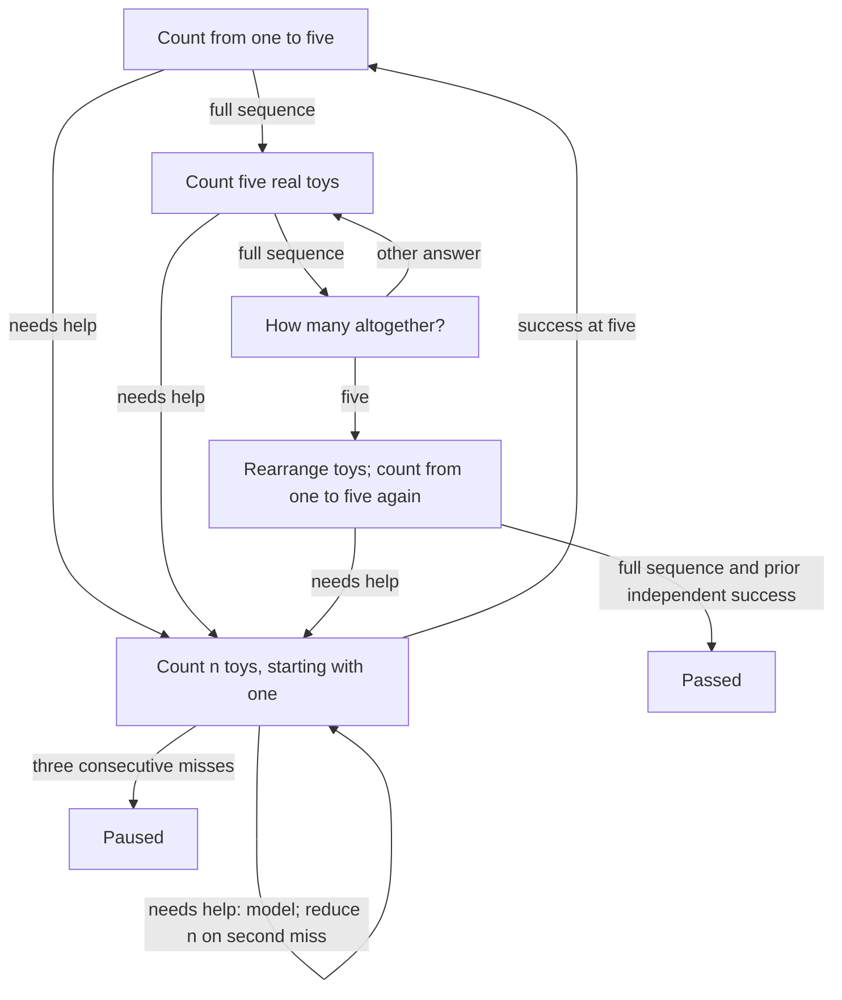
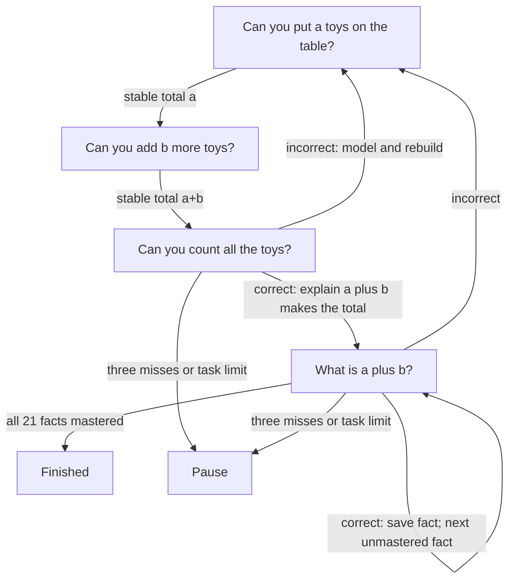

# unmath

Rust counting and addition lesson modules for unengine apps. It depends only on the public `un-core`
strategy interface, performs no I/O, and uses no network services.

Lesson IDs: `unmath-count-to-five` and `unmath-add-to-five`.
English and Russian prompts are included. `unmath::register` registers both.

## Plug into an app

Keep this checkout next to `unengine` (the dependency path in `Cargo.toml` expects
`../unengine`). Add this dependency to the **product binary or mobile library**:

```toml
[dependencies]
unmath = { path = "../unmath" } # adjust relative to the product's Cargo.toml
```

Explicit registration is reliable even when static linking drops unused crates:

```rust
let mut registry = un_core::strategy::StrategyRegistry::linked();
unmath::register(&mut registry);
let config = un_core::strategy::SessionConfig {
    total_objects: 5,
    max_tasks: 40,
    ..Default::default()
};
let strategy = registry.create(unmath::ID, &config).unwrap();
// Pass strategy and config to un_engine::Engine::new, as in unengine's demo.
```

For a desktop product with `un-desktop` as a dependency:

```rust
fn main() -> Result<(), Box<dyn std::error::Error>> {
    let mut registry = un_core::strategy::StrategyRegistry::linked();
    unmath::register(&mut registry);
    un_desktop::run(registry)?;
    Ok(())
}
```

Select **Lesson 1: count to five** in the app's strategy selector. Registration
also participates in `inventory`, so a CLI product can retain the crate with
`unmath::register(&mut un_core::strategy::StrategyRegistry::new());` before
calling `un_cli::main()`. Select it with
`lesson --strategy unmath-count-to-five`.

For a mobile product, call this in the Rust startup function invoked by the app,
before listing or creating sessions:

```rust
un_ffi::add_strategies(unmath::register);
```

Build the product library and regenerate its Swift/Kotlin bindings using the
unengine workflow. This crate is a linked Rust strategy, not a dynamically loaded
plugin; existing prebuilt apps must be rebuilt with it.

## Lesson graph



Passing requires two independent exact sequences `[1, 2, 3, 4, 5]`, separated
by counting five real toys and answering the total. Guided practice does not
satisfy either independent check. Every practice count is modeled first using
speech and `HighlightCount`; the tutor then asks for a separate child attempt.
An adult may help prepare each set. All materials are called “toys”; use a detector
configuration that counts all the toys on the lesson table.

Counting questions use `ListenMode::Counting`. The strategy caches `Numbers`
and judges on the following `Heard`, so that trailing event cannot answer the
next question. A single final number or number-pad tap does not prove counting.
`Counted` is informational and never scores an attempt.

Object questions wait for a stable table with the required total. Table changes
invalidate the pending count. Rearrangement is an invitation; the API cannot
verify that rearrangement occurred, or that the child pointed once at every toy.
Speech recognition errors may require repeating a question; silence does not
create a failed task record. Three consecutive unsuccessful responses/timeouts
pause the session. Repeat restarts the current question; skip is recorded and
routes into practice. Stop and the configured task limit pause without mastery.
There is no enforced wall-clock limit, including while waiting for toy setup.

Persist `SessionSummary.remember` with `apply_remembered` and supply the resulting
map as the next `SessionConfig.extra`. A paused lesson remembers its first
independent success and resumes at the five-toy activity; other progress restarts
at the first independent check. Successful completion clears that checkpoint.
The module reports mastery only with `PhaseKind::Finished` and a non-paused
summary. `correct` counts successful individual questions, not mastered lessons.

## Verify

```sh
cargo test
cargo clippy --all-targets -- -D warnings
cargo fmt --check
```

The tests exercise the strategy API; camera, microphone, and mobile/desktop builds
must be checked in the host product. No files in `unengine` are changed.


## Lesson 2: add up to five

Use `unmath::ADDITION_ID` (`unmath-add-to-five`) in the registry, or select
**Lesson 2: add up to five** in the app. The same registration code above includes
both lessons. The child should already be able to count five objects.

The lesson teaches addition as joining sets: prepare `a` toys, add `b` more,
then count the combined set. An adult can help prepare materials. At most five
toys are needed. A `1 + 1` demonstration introduces the activity before independent
questions begin. Fingers are allowed for independent answers; fluent recall is
not required.

Acceptance: correctly answer every ordered pair of nonnegative operands with
`a + b <= 5` in an independent question (21 facts, including `0 + 0`, `0 + 5`,
and `5 + 0`). Reversed operands are checked separately. Toy-assisted practice
never marks a fact mastered. This is a lesson completion check, not a delayed
retention assessment.



For adding zero, no table change is required. An empty set is answered with
zero in voice mode; other guided sums require the complete spoken count in
counting mode. Independent sums accept a spoken total or number-pad answer.
Practice moves to another unchecked fact before returning to the failed fact
when possible. Table changes during guided counting cancel that attempt and
restart set preparation. The camera verifies totals, not which individual toys
were added or how the child reasoned.

Set `max_tasks` to about 40 for a longer session, or use shorter sessions and
persist `SessionSummary.remember` through `apply_remembered`. The checkpoint
`unmath.lesson2.mastered` stores mastered facts; a resumed session asks only
unfinished facts. Three consecutive mistakes/timeouts, Stop, or the task limit
pause without declaring mastery. Silence does not create a task record. Repeat
reissues the current prompt. Skipping an answer records a skip and starts
practice; skipping toy setup pauses. Setup has no enforced time limit.

Passing emits a non-paused summary and `PhaseKind::Finished`; `final_level` is
the number of mastered facts (21 at completion), while `correct` also includes
guided successes. Completion clears this lesson's checkpoint. Existing lesson-one
progress uses a separate key.


## Wiki question graphs

See the [lesson wiki](https://github.com/sealsbroken/unmath/wiki) for rendered Mermaid
directed acyclic graphs of each lesson. Source pages are kept in `docs/wiki`.
The graphs show forward teaching passes; retry leaves start a new pass while
the lesson implementations keep their practice cycles.

## License

This repository is licensed under the GNU Lesser General Public License,
version 3 or (at your option) any later version (`LGPL-3.0-or-later`).
See [LICENSE](LICENSE) for the LGPL terms and [LICENSE.GPL](LICENSE.GPL)
for the incorporated GPL version 3 terms.
