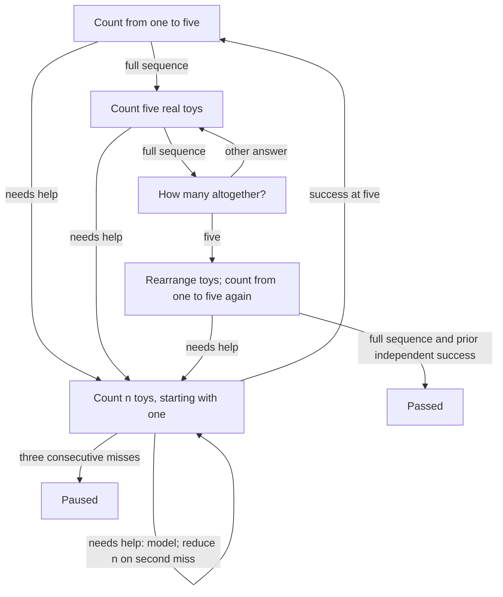

# unmath

A Rust lesson module for unengine apps. It depends only on the public `un-core`
strategy interface, performs no I/O, and uses no network services.

Lesson ID: `unmath-count-to-five`. English and Russian prompts are included.

## Plug into an app

Keep this checkout next to `unengine` (the dependency path in `Cargo.toml` expects
`../unengine`). Add this dependency to the **product binary or mobile library**:

```toml
[dependencies]
unmath = { path = "../unmath" } # adjust relative to the product's Cargo.toml
```

Explicit registration is reliable even when static linking drops unused crates:

```rust
let mut registry = un_core::strategy::StrategyRegistry::linked();
unmath::register(&mut registry);
let config = un_core::strategy::SessionConfig {
    total_objects: 5,
    max_tasks: 40,
    ..Default::default()
};
let strategy = registry.create(unmath::ID, &config).unwrap();
// Pass strategy and config to un_engine::Engine::new, as in unengine's demo.
```

For a desktop product with `un-desktop` as a dependency:

```rust
fn main() -> Result<(), Box<dyn std::error::Error>> {
    let mut registry = un_core::strategy::StrategyRegistry::linked();
    unmath::register(&mut registry);
    un_desktop::run(registry)?;
    Ok(())
}
```

Select **Lesson 1: count to five** in the app's strategy selector. Registration
also participates in `inventory`, so a CLI product can retain the crate with
`unmath::register(&mut un_core::strategy::StrategyRegistry::new());` before
calling `un_cli::main()`. Select it with
`lesson --strategy unmath-count-to-five`.

For a mobile product, call this in the Rust startup function invoked by the app,
before listing or creating sessions:

```rust
un_ffi::add_strategies(unmath::register);
```

Build the product library and regenerate its Swift/Kotlin bindings using the
unengine workflow. This crate is a linked Rust strategy, not a dynamically loaded
plugin; existing prebuilt apps must be rebuilt with it.

## Lesson graph



Passing requires two independent exact sequences `[1, 2, 3, 4, 5]`, separated
by counting five real toys and answering the total. Guided practice does not
satisfy either independent check. Every practice count is modeled first using
speech and `HighlightCount`; the tutor then asks for a separate child attempt.
An adult may help prepare each set. All materials are called “toys”; use a detector
configuration that counts all the toys on the lesson table.

Counting questions use `ListenMode::Counting`. The strategy caches `Numbers`
and judges on the following `Heard`, so that trailing event cannot answer the
next question. A single final number or number-pad tap does not prove counting.
`Counted` is informational and never scores an attempt.

Object questions wait for a stable table with the required total. Table changes
invalidate the pending count. Rearrangement is an invitation; the API cannot
verify that rearrangement occurred, or that the child pointed once at every toy.
Speech recognition errors may require repeating a question; silence does not
create a failed task record. Three consecutive unsuccessful responses/timeouts
pause the session. Repeat restarts the current question; skip is recorded and
routes into practice. Stop and the configured task limit pause without mastery.
There is no enforced wall-clock limit, including while waiting for toy setup.

Persist `SessionSummary.remember` with `apply_remembered` and supply the resulting
map as the next `SessionConfig.extra`. A paused lesson remembers its first
independent success and resumes at the five-toy activity; other progress restarts
at the first independent check. Successful completion clears that checkpoint.
The module reports mastery only with `PhaseKind::Finished` and a non-paused
summary. `correct` counts successful individual questions, not mastered lessons.

## Verify

```sh
cargo test
cargo clippy --all-targets -- -D warnings
cargo fmt --check
```

The tests exercise the strategy API; camera, microphone, and mobile/desktop builds
must be checked in the host product. No files in `unengine` are changed.
