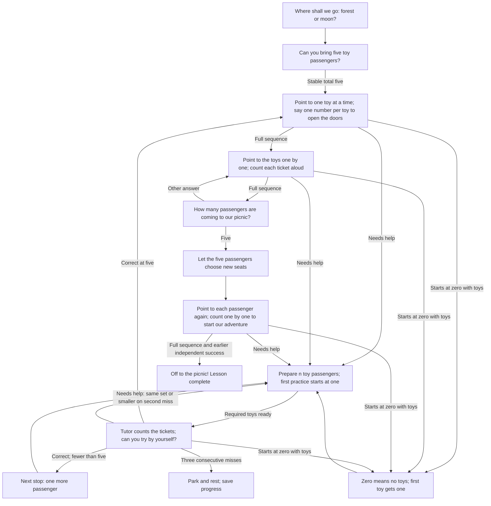
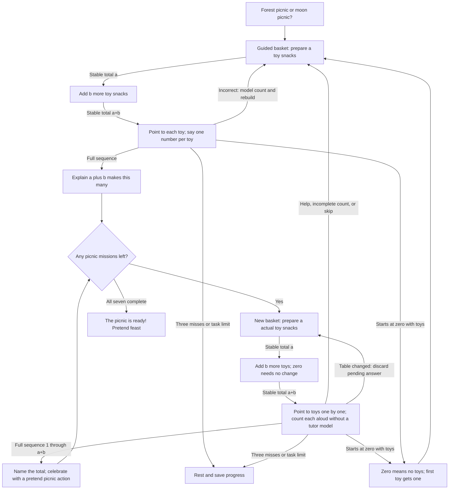

# unmath

Ten play-based arithmetic lessons for unengine apps. It depends only on the public `un-core`
strategy interface, performs no I/O, and uses no network services.

Lesson IDs: `unmath-count-to-five` and `unmath-add-to-five`.
English and Russian prompts are included. `unmath::register` registers all ten.

## Plug into an app

Keep this checkout next to `unengine` (the dependency path in `Cargo.toml` expects
`../unengine`). Add this dependency to the **product binary or mobile library**:

```toml
[dependencies]
unmath = { path = "../unmath" } # adjust relative to the product's Cargo.toml
```

Explicit registration is reliable even when static linking drops unused crates:

```rust
let mut registry = un_core::strategy::StrategyRegistry::linked();
unmath::register(&mut registry);
let config = un_core::strategy::SessionConfig {
    total_objects: 5,
    max_tasks: 40,
    ..Default::default()
};
let strategy = registry.create(unmath::ID, &config).unwrap();
// Pass strategy and config to un_engine::Engine::new, as in unengine's demo.
```

For a desktop product with `un-desktop` as a dependency:

```rust
fn main() -> Result<(), Box<dyn std::error::Error>> {
    let mut registry = un_core::strategy::StrategyRegistry::linked();
    unmath::register(&mut registry);
    un_desktop::run(registry)?;
    Ok(())
}
```

Select **Lesson 1: five passengers** in the app's strategy selector. Registration
also participates in `inventory`, so a CLI product can retain the crate with
`unmath::register(&mut un_core::strategy::StrategyRegistry::new());` before
calling `un_cli::main()`. Select it with
`lesson --strategy unmath-count-to-five`.

For a mobile product, call this in the Rust startup function invoked by the app,
before listing or creating sessions:

```rust
un_ffi::add_strategies(unmath::register);
```

Build the product library and regenerate its Swift/Kotlin bindings using the
unengine workflow. This crate is a linked Rust strategy, not a dynamically loaded
plugin; existing prebuilt apps must be rebuilt with it.

## Play adventures

The child chooses a forest picnic by bus or a moon picnic by rocket. Any five
recognizable toys become passengers, then pretend snacks for bears or aliens.
English and Russian prompts support story choices, ticket checks, basket packing,
and playful celebrations. Say `help` to build with toys, or `stop` / `I'm tired`
to pause. No special props are needed. Pretend actions are spoken invitations;
the engine does not render story scenes or judge pretend play.

### Lesson 1: Five passengers

Open the doors by counting, check each passenger's ticket, let the toys choose
new seats, and count again to start the engine. Passing still requires two
independent exact sequences `[1, 2, 3, 4, 5]`, with one number per real toy,
separated by the five-toy activity
and its total. Guided practice never earns an independent sequence check.




### Lesson 2: Picnic baskets

Pack a guided basket, then solve seven story missions: `1+1`, `1+2`, `2+2`,
`2+3`, `3+1`, `1+4`, and `3+0`. Independent one-by-one toy counts earn pretend picnic actions
and move to the next basket. Help returns to combining toys, counting, and a
fresh mission. Two different ways to make five are included. Completion checks
these seven challenges; it does not claim recall of every addition fact.



Both graphs are directed and cyclic: arrows lead back to earlier questions during
practice and onward through repeated missions. See the [wiki](https://github.com/sealsbroken/unmath/wiki)
for examples, acceptance criteria, child controls, and resume behavior. Page sources
are in `docs/wiki`.

## Next eight lessons: 3–10

See the [curriculum plan](docs/CURRICULUM.md) for sequencing, prerequisites, and
acceptance criteria. Each adventure has six missions and a directed cyclic
question graph in the wiki:

| Lesson | Strategy ID | Skill |
| --- | --- | --- |
| [3: Cave train](https://github.com/sealsbroken/unmath/wiki/Lesson-3-Cave-train) | `unmath-subtract-to-five` | Taking away within five |
| [4: Bridge builders](https://github.com/sealsbroken/unmath/wiki/Lesson-4-Bridge-builders) | `unmath-compare-to-five` | More, fewer, and equal within five |
| [5: Parcel detectives](https://github.com/sealsbroken/unmath/wiki/Lesson-5-Parcel-detectives) | `unmath-missing-to-five` | Missing addends within five |
| [6: Firefly gates](https://github.com/sealsbroken/unmath/wiki/Lesson-6-Firefly-gates) | `unmath-count-to-ten` | Ordered counting through ten |
| [7: Supply launch](https://github.com/sealsbroken/unmath/wiki/Lesson-7-Supply-launch) | `unmath-add-to-ten` | Combining quantities with totals six through ten |
| [8: Homeward trail](https://github.com/sealsbroken/unmath/wiki/Lesson-8-Homeward-trail) | `unmath-subtract-to-ten` | Taking away within ten |
| [9: Ten-seat ferry](https://github.com/sealsbroken/unmath/wiki/Lesson-9-Ten-seat-ferry) | `unmath-make-ten` | Complements to ten |
| [10: Fair-share café](https://github.com/sealsbroken/unmath/wiki/Lesson-10-Fair-share-cafe) | `unmath-share-between-two` | Equal sharing between two |

All are registered by the existing `unmath::register` function. Direct use:

```rust
use unmath::curriculum::{Adventure, Lesson, NEXT_LESSONS};
let strategy = Adventure::new(Lesson::CaveTrain, config.clone());
// Or registry.create(Lesson::CaveTrain.id(), &config).
// NEXT_LESSONS lists the eight new lessons in teaching order.
```

Lessons 3–5 require five recognizable toys; 6–10 require ten. Set `total_objects`
accurately: a lesson pauses with a materials prompt if the configured supply is
insufficient. Each independent success advances one mission; toy-guided counts
never complete missions. The default ten-task session fits six uninterrupted
missions. Separate checkpoints retain progress if help uses the remaining tasks.
See each wiki page for its specific physical help stages, accepted answers, and
perception limits. The shared runtime is not a claim that the lessons teach the
same operation: subtraction removes toys, missing quantities add to a target,
comparison counts two supplies, and sharing deals alternately to two guests.

## Integration behavior

`unmath::ID` and `unmath::ADDITION_ID` are unchanged. Registration includes all ten
lessons. Choose a destination by saying `forest` / `moon` (`лес` / `луна`) or
by tapping 1 / 2. Destination choices never score as maths answers. Help requests
(`help`, `help me`, `I don't know`, `помоги`, `не знаю`) enter toy practice without
scoring a mistake. Break requests (`stop`, `break`, `I'm tired`, `стоп`, `перерыв`,
`я устал`, `я устала`) pause, including during toy setup.

Counting checks use full `Numbers` sequences, judged on the following `Heard`
event so the same response cannot answer the next question. Lessons 1–2 use
actual toys and complete spoken counts, one number per toy.
Lesson two prepares the starting set and combined set before each independent
count; a final-number tap cannot complete a basket. Its tutor names the total
after the full count. Later independent arithmetic answers can still be spoken
or tapped; guided toy counts always require the full sequence. Stable
table totals gate toy tasks; table changes cancel pending toy counts. The strategy
cannot verify one touch per toy or pretend actions.

Three consecutive unsuccessful responses/timeouts or the task limit pause;
silence creates no failed task record. Repeat reissues a prompt; Skip records
an answer as skipped and enters practice, while skipping toy setup pauses.
Setup has no enforced timeout. Default ten tasks fits each uninterrupted adventure;
use shorter sessions and resume as needed.

Persist `SessionSummary.remember` via `apply_remembered`, then supply it in the
next `SessionConfig.extra`. Counting keeps the first independent toy-count
success under
`unmath.lesson1.one_by_one.v2`;
addition keeps completed picnic missions under `unmath.lesson2.one_by_one.v3`.
Older recitation/final-number checkpoints are not reused. Each lesson also
remembers its destination.
Completion clears its checkpoint. Only `PhaseKind::Finished` and a non-paused
summary mean completion; `correct` also includes guided responses.

## Edge-case audit

See [the audit](docs/EDGE_CASES.md) for counterexamples, regression coverage,
and explicit limits. Zero-prefixed toy counts are rejected with an explanation;
zero remains valid for an empty set. Supported restart/help/break commands tolerate
recognizer punctuation and case. Invalid saved masks and timeout values are
validated. Update `sealsbroken/unengine` too: the speech parser must preserve
explicit zero, and cached pre-start toys must reach the active strategy.

## Verify

```sh
cargo test
cargo clippy --all-targets -- -D warnings
cargo fmt --check
```

Tests exercise strategy events and effects. Camera, microphone, and host app
builds need testing in the product. No `unengine` changes are required.

## License

This repository is licensed under the GNU Lesser General Public License,
version 3 or (at your option) any later version (`LGPL-3.0-or-later`).
See [LICENSE](LICENSE) and the incorporated [GPL terms](LICENSE.GPL).
