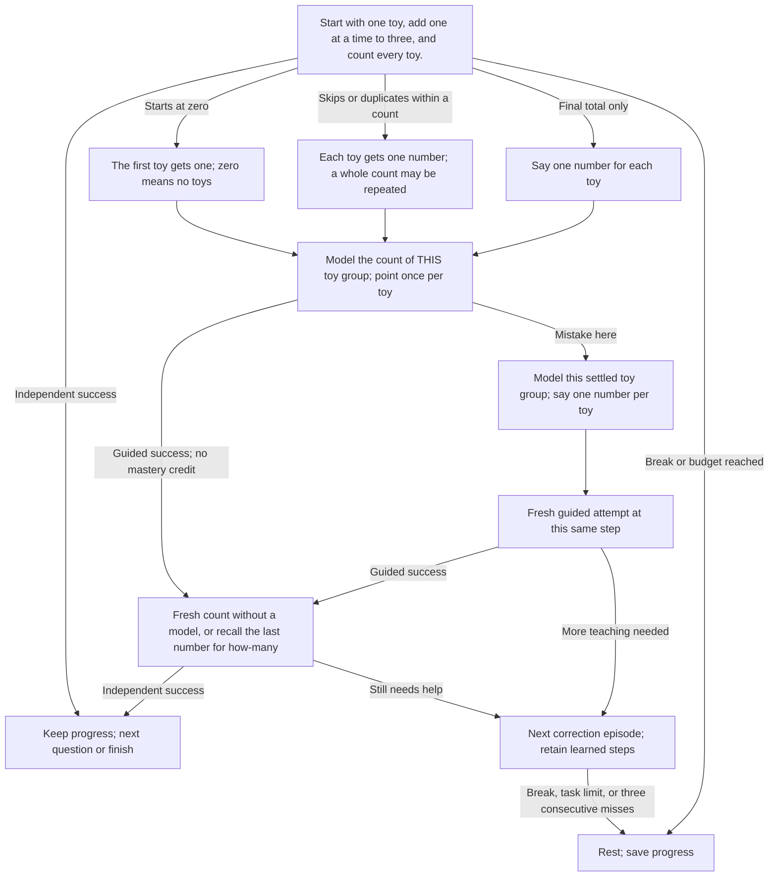
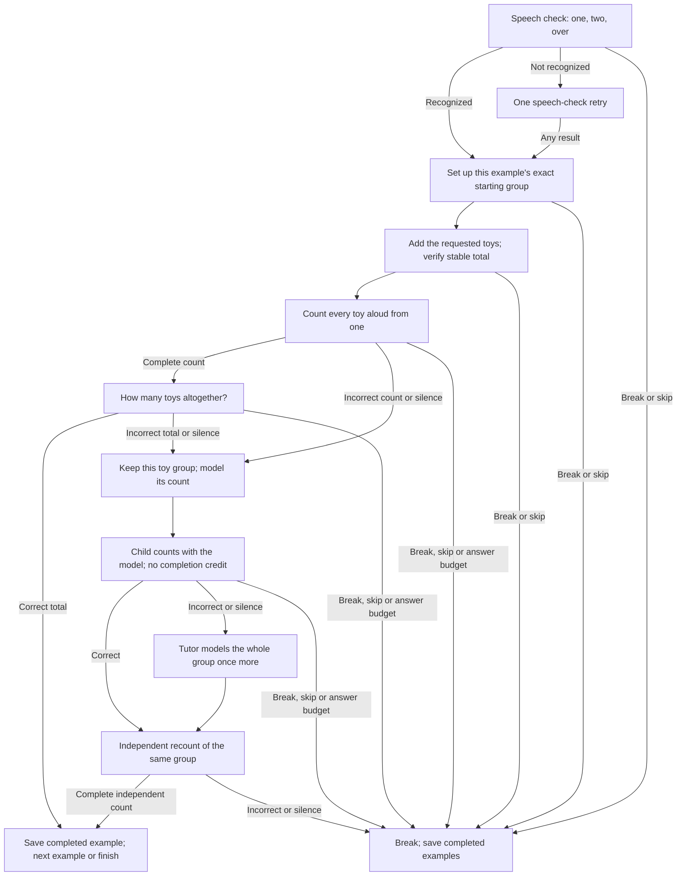

# unmath

Ten play-based arithmetic lessons for unengine apps. It depends only on the public `un-core`
strategy interface, performs no I/O, and uses no network services.

Lesson one now registers `unmath-count-to-three`; update apps using the old
`unmath-count-to-five` ID. `CountToFive` remains a Rust compatibility alias.

Lesson IDs: `unmath-count-to-three` and `unmath-add-to-five`.
English and Russian prompts are included. `unmath::register` registers all ten.

## Plug into an app

Keep this checkout next to `unengine` (the dependency path in `Cargo.toml` expects
`../unengine`). Add this dependency to the **product binary or mobile library**:

```toml
[dependencies]
unmath = { path = "../unmath" } # adjust relative to the product's Cargo.toml
```

Explicit registration is reliable even when static linking drops unused crates:

```rust
let mut registry = un_core::strategy::StrategyRegistry::linked();
unmath::register(&mut registry);
let config = un_core::strategy::SessionConfig {
    total_objects: 5,
    max_tasks: 40,
    ..Default::default()
};
let strategy = registry.create(unmath::ID, &config).unwrap();
// Pass strategy and config to un_engine::Engine::new, as in unengine's demo.
```

For a desktop product with `un-desktop` as a dependency:

```rust
fn main() -> Result<(), Box<dyn std::error::Error>> {
    let mut registry = un_core::strategy::StrategyRegistry::linked();
    unmath::register(&mut registry);
    un_desktop::run(registry)?;
    Ok(())
}
```

Select **Lesson 1: count three toys** in the app's strategy selector. Registration
also participates in `inventory`, so a CLI product can retain the crate with
`unmath::register(&mut un_core::strategy::StrategyRegistry::new());` before
calling `un_cli::main()`. Select it with
`lesson --strategy unmath-count-to-three`.

For a mobile product, call this in the Rust startup function invoked by the app,
before listing or creating sessions:

```rust
un_ffi::add_strategies(unmath::register);
```

Build the product library and regenerate its Swift/Kotlin bindings using the
unengine workflow. This crate is a linked Rust strategy, not a dynamically loaded
plugin; existing prebuilt apps must be rebuilt with it.

## Arithmetic with toys

Lessons start directly with toys; lesson two first checks speech with “one, two, over.” There is no forest/moon choice, no request
for grown-up help, and no assumption that toys represent food, characters, or
other objects. English and Russian prompts talk only about toys and toy groups.
Everything is screen free: the child speaks, points, and moves toys.

### Lesson 1: Count three toys

Start with one toy, add one at a time to three, and count every toy.



### Lesson 2: Add toys up to five

Speech check, then eight ordered examples: **1+1, 1+2, 2+2, 2+3, 3+1, 1+4,
3+0, 1+1**. Each needs a full count and a separate total. Errors keep the same
toy group, teach with a model, then ask for an independent recount. A failed
final recount pauses with completed examples saved. Use `max_tasks: 40` for a
whole lesson with room for corrections (a clean run uses 16 responses).



## All ten lessons

| Lesson | Strategy ID | Goal |
| --- | --- | --- |
| [1: Count three toys](https://github.com/sealsbroken/unmath/wiki/Lesson-1-Count-to-three) | `unmath-count-to-three` | Start with one toy, add one at a time to three, and count every toy. |
| [2: Add toys up to five](https://github.com/sealsbroken/unmath/wiki/Lesson-2-Add-up-to-five) | `unmath-add-to-five` | Join toy groups with totals up to five and count the combined group. |
| [3: Take toys away up to five](https://github.com/sealsbroken/unmath/wiki/Lesson-3-Cave-train) | `unmath-subtract-to-five` | Take toys away within five and count those remaining, including zero. |
| [4: Compare toy groups](https://github.com/sealsbroken/unmath/wiki/Lesson-4-Bridge-builders) | `unmath-compare-to-five` | Compare two toy groups within five: more, fewer, or equal. |
| [5: Add missing toys up to five](https://github.com/sealsbroken/unmath/wiki/Lesson-5-Parcel-detectives) | `unmath-missing-to-five` | Find how many toys must be added to reach a target up to five. |
| [6: Count toys to ten](https://github.com/sealsbroken/unmath/wiki/Lesson-6-Firefly-gates) | `unmath-count-to-ten` | Count toys in order through ten, with a second independent count to ten. |
| [7: Add toys up to ten](https://github.com/sealsbroken/unmath/wiki/Lesson-7-Supply-launch) | `unmath-add-to-ten` | Join toy groups with totals from six through ten. |
| [8: Take toys away up to ten](https://github.com/sealsbroken/unmath/wiki/Lesson-8-Homeward-trail) | `unmath-subtract-to-ten` | Take toys away within ten and count those remaining. |
| [9: Make ten toys](https://github.com/sealsbroken/unmath/wiki/Lesson-9-Ten-seat-ferry) | `unmath-make-ten` | Find how many toys must be added to make ten. |
| [10: Split toys into equal groups](https://github.com/sealsbroken/unmath/wiki/Lesson-10-Fair-share-cafe) | `unmath-share-between-two` | Split even numbers of toys up to ten into two equal groups. |

See the [curriculum](docs/CURRICULUM.md) and [wiki](https://github.com/sealsbroken/unmath/wiki)
for materials, task lists, acceptance criteria, and correction paths. Legacy
strategy IDs and wiki page URLs stay stable; display titles and speech use toys.

## Answers and corrections

In Russian, **«раз» is accepted as «один»**: `раз, два` and repeated complete
counts such as `раз, два, раз, два` are valid for two toys. The tutor may model
`один`; either word is accepted. `Ещё раз` / `повтори ещё раз` requests a replay
without becoming the numerical answer one. Zero and skipped numbers still need
correction.

Counts use a complete `Numbers` event followed by the matching `Heard` event.
A whole correct answer may repeat: `1,2,1,2` for two toys is one correct response.
Long complete repetitions are validated in full before diagnostics are compacted.
Skipped numbers, duplicates inside a count, incomplete restarts, and zero with
nonempty toy groups need correction. Empty groups accept zero.

A mistake opens concrete guided steps, followed by a fresh independent check.
Guided work cannot complete an independent task. The next teaching question after
an incorrect spoken answer begins “А ты уверен?” / “Are you sure?” once. Skips
and silence do not trigger this prefix. Too many added toys are corrected by
undoing ALL new toys, restoring the original group, and retrying the addition.
The tutor never asks a beginner to subtract the excess.

Say `help` / `помоги`, `start again` / `сначала`, or `stop` / `стоп`. Three
consecutive misses/timeouts or the task limit pause in the other lessons. Lesson two
instead uses the bounded correction path above: silence follows the same teaching
steps and is recorded as an unanswered attempt. Skip during setup pauses. Physical
setup has no timeout.

## Integration and saved progress

`Event::Start` immediately starts the current toy task. No meeting or destination
answer is required. Old destination values are ignored and cleared when saving.
Persist `SessionSummary.remember` via `apply_remembered` and pass it in the next
`SessionConfig.extra`. Existing counting and arithmetic progress keys are kept.
Only `PhaseKind::Finished` and a non-paused summary indicate completion; the
`correct` count includes guided successes.

Set `total_objects` to the available toys. Lesson one can begin with one and
pause at the next group if more toys are needed. Lessons 2–5 require five and
6–10 require ten. The default ten-task budget fits uninterrupted completion;
allow a larger budget for teaching branches or pause and resume.

The camera checks settled totals. It cannot prove individual touches, which
toys were moved, or matching and splitting outside its counting area.
See the [edge-case audit](docs/EDGE_CASES.md) for regression coverage and limits.

## Verify

```sh
cargo test
cargo clippy --all-targets -- -D warnings
cargo fmt --check
```

Tests cover direct starts, plain-toy speech in both languages, arithmetic,
correction paths, repetitions, saved progress, and real-engine speech integration.
Camera, microphone, and host app builds need verification in the product.

## License

GNU Lesser General Public License version 3 or later (`LGPL-3.0-or-later`).
See [LICENSE](LICENSE) and its incorporated [GPL terms](LICENSE.GPL).

---

Contact: [lead@onym.app](mailto:lead@onym.app)
