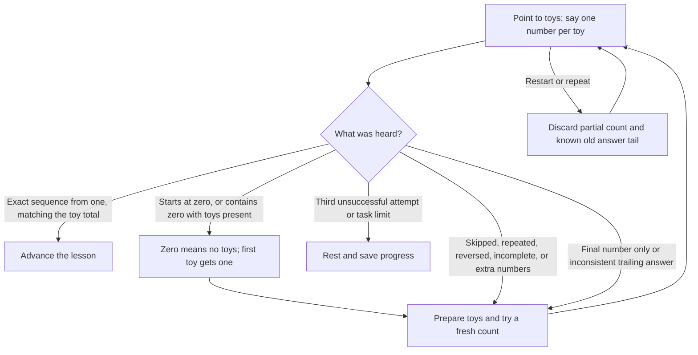

# Lesson and speech-boundary audit

The lesson diagrams show **acyclic correction paths**, with distinct attempt nodes.
Mistakes preserve the current question and completed work. Tests
exercise all ten strategies, plus the real unengine speech/effect runtime.

## The zero counterexample

Before the fix, the engine removed every zero in counting mode:

```text
Child:       zero, one, two, three, four, five
Old engine:        one, two, three, four, five
Old result:  an incorrect count could pass
```

Now explicit `zero`, `0`, `ноль`, and `нуль` are retained. The count is rejected
and the tutor says: “Zero means no toys. Point to the first toy and say one.
Let's try again.” The lesson returns to toy practice; no mission is completed.
Conversational negatives such as Russian `нет` remain speech during a count.
Zero is accepted when answering an empty-group question, such as `2 - 2`.



This is the counting-error policy, not a replacement for each lesson's story graph.
An empty-set question uses a spoken total of zero rather than this positive-toy
sequence check.

## Counterexamples and expected behavior

| Input or situation | Behavior covered by tests |
| --- | --- |
| `0,1,2,3…`, or zero inserted in the middle | Reject; explain zero versus the first toy; retry the same question |
| Starts at two or another number | Reject; ask to start at one |
| Missing a number | Reject; count again in order |
| Repeated number | Reject; one number per toy |
| Reversed or swapped numbers | Reject |
| Goes past the last toy | Reject; stop after each toy was counted once |
| Says only the total, or taps it during a counting task | Cannot satisfy a full count |
| Count has 10,000 entries | Reject; keep bounded diagnostic context instead of persisting the entire transcript |
| A correct `Numbers` sequence followed by a conflicting `Heard` | Reject; the final event must agree |
| Partial `Counted` chunks, including pauses | Never score before the final `Numbers`/`Heard` pair |
| `start again`, `restart`, `сначала` | Clear the pending count and reissue the current prompt; no error score |
| Repeat/table change between `Numbers` and its trailing `Heard` | Discard the known old trailing event; do not grade it as a new attempt |
| Wrong, missing, or unstable toys during a toy task | Wait or re-prepare; do not score the canceled count |
| Table changes during an independent oral firefly count | Do not cancel: this question has no table precondition |
| Explicit negative number or out-of-parser-range numeric token | Engine marks it invalid instead of dropping it into a passing positive answer |
| `2 - 2`, empty table, spoken zero | Correct; zero is not globally forbidden |
| `none`/`нет` in counting mode | Ordinary speech, not an inserted zero |
| Punctuation, capitalization, curly apostrophe, repeated spaces in commands | Normalize before matching supported help/restart/break/choice phrases |
| Three invalid destination choices | Rest without recording maths mistakes |
| Repeated silence | Rest after three timeouts; silence does not create a failed task record |
| Too many toys added | Undo the entire added group, verify original total, then repeat the same addition; never subtract the excess |
| `help` | Begin toy practice without scoring an error; recheck the same mission afterward |
| Stop or a supported tired/break phrase | Pause, save progress, stop listening |
| Skip during a question | Record a skipped attempt, never award mastery |
| Skip while arranging toys | Pause without inventing a failed maths answer |
| `max_tasks = 0` | Pause before asking/scoring maths |
| Too few configured materials | Pause at a task needing more toys; lesson one can begin with one available toy |
| NaN, infinite, negative, zero, or extreme listening timeout | Use the default finite listening window |
| Invalid/overflowing/negative saved mask or out-of-range mask bits | Reset that mask, rather than masking it into full mastery |
| Stored all-complete mask | Reset: successful completion normally clears the checkpoint |
| Invalid saved mission index | Use a bounded starting index |
| Paused/finished lesson receives late answers, repeats, skips, Start, or Stop | No extra scores, effects, or completion summaries |
| Toys were visible before engine Start | Replay the cached observation under the strategy lock; do not wait forever for an unchanged table |

## Automated evidence

- `tests/addition_setup.rs`: overshoot rollback in both languages, repeated attempts,
  zero additions, empty starting groups, stale speech, and preserving guided stages.


- `tests/adversarial.rs`: mutation tests for counting and controls in all ten
  lessons, both languages, plus 40,960 seeded mixed-event steps. These include
  valid and invalid inputs, restarts, setup, and terminal states.
- `tests/graphs.rs`: every published correction graph is acyclic;
  declared nodes are reachable from the start; every nonterminal node has a path
  to success or rest; terminal exits have no outgoing edges.
- `tests/speech_boundary.rs`: the real engine delivers a zero-prefixed count to
  the lesson unchanged in English and Russian. A spoken restart discards the
  zero prefix and lets a fresh count pass.
- `unengine` regressions cover explicit zeros, conversational negatives, signs,
  numeric overflow, and pre-start table observations. Its full workspace is
  checked on the isolated engine patch, without unrelated local edits.

Update the sibling `sealsbroken/unengine` checkout as well as `unmath` before
building. The required engine fixes are in [commit 3b20dd2](https://github.com/sealsbroken/unengine/commit/3b20dd2). The engine parsing and pre-start observation fixes are necessary;
strategy-only tests cannot detect information already erased by the engine.

## Limits and deliberate policies

This is a tested edge-case catalogue, not proof of every possible child behavior.

The strategy receives recognized numbers and table totals, not raw speech or
per-toy touch identities. It cannot prove that every physical touch is unique,
correct a recognizer that invents an otherwise valid full sequence, or verify
fair distribution from a total alone. An adult can observe these actions.

Events have no question ID. We can discard a known canceled `Numbers` tail, but
cannot unambiguously identify every arbitrary replay of a standalone correct
number after the next question has started. Stronger provenance requires an
engine event-contract change. The tests do not claim to solve that ambiguity.

In a counting task, “1,2… no,1,2,3” is not silently repaired. Say “start again”
for a fresh count. Later scalar arithmetic intentionally permits a corrected final
answer (“four, no, five”); this is separate from counting one number per toy.

The engine currently ends a partial spoken count after its silence gap (normally
five seconds), and waits about 1.5 seconds after the expected final number. A
long pause may require a fresh attempt. Microphone/ASR failure cannot be treated
as proof of counting; a tap does not replace the spoken sequence.

Cycles involving help, repeat, arranging toys, or chatter can continue while the
child plays. The graphs guarantee reachable exits, not forced termination for
every infinite input stream. Stop/break exits remain available; setup has no
forced time limit. Human usability and retention still need observation.
