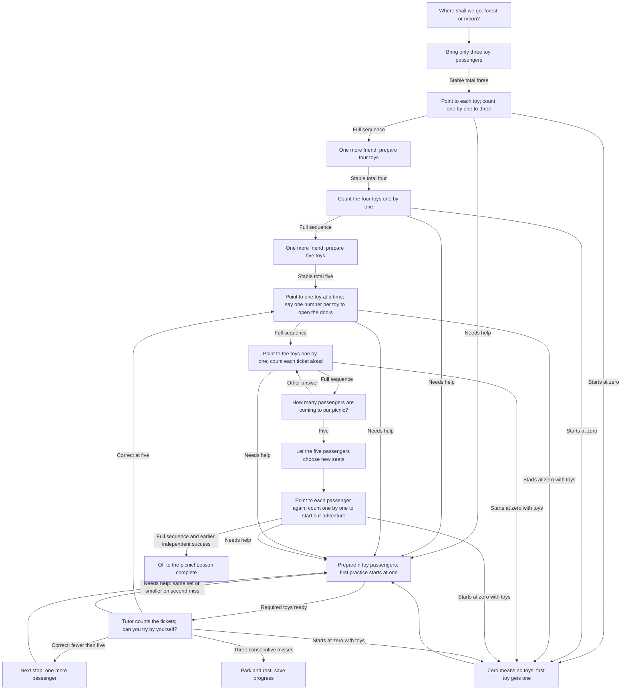

# Lesson 1: Five passengers

The child is the captain. Their toys are passengers waiting for a picnic trip.
They choose **forest** (a bus with “beep beep”) or **moon** (a rocket with
“whoosh”). Counting opens the doors, checks tickets, and starts the engine.
Start with **only three toys on the table**. After a successful count, bring
one more passenger, then one more: **three → four → five**. The child chooses
who each passenger is. Five toys are needed eventually, but three are enough
to begin.

Example: “Ticket check! Can you point to each toy passenger and count them aloud?”
When everyone has a ticket: “Let the five passengers choose new seats!” The child
moves their toys and gives the departure count. These are spoken invitations to
pretend play; there is no bus or rocket animation in the engine.

## Directed cyclic question graph

Arrows returning to earlier questions are actual strategy transitions. Help is
part of the adventure: use a smaller passenger group, count together, and try
again. A cycle can be repeated, with success and rest as reachable exits.

## What counts as success?

Every counting question uses real toys and asks for one number per toy.
The child independently says `1, 2, 3, 4, 5` twice, separated by the ticket-check
activity and its total. The opening counts use three toys, then four. They build toward the goal but
do not replace the independent five-toy checks. Every count waits for its actual
toy group; it is not a free recitation. The total-only question follows a completed full count. No skipped or repeated numbers. Guided
practice and a final number alone cannot satisfy an independent sequence check.
The story provides a reason to count; the count remains the acceptance criterion.

## Child controls and engine behavior

- Choose by saying `forest` / `moon` (`лес` / `луна`).
- Say `help` / `help me` / `I don't know` (`помоги` / `не знаю`) during a question
  to begin with one passenger. Asking for help does not score an error.
- Say `stop`, `break`, or `I'm tired` (`стоп`, `перерыв`, `я устал`, `я устала`)
  to pause. Say `start again` (`сначала`) to repeat the current prompt. No screen is needed.
- Stable table totals gate toy questions. Table changes cancel pending answers.
  The camera cannot verify one touch per passenger or seating changes.
- Three consecutive unsuccessful responses/timeouts, Stop, or the task limit
  pause. Silence does not create a failed task record. Toy setup has no timeout.
- Save `SessionSummary.remember` to keep the chosen destination and first
  independent success. Resuming after that success returns to the five-passenger
  activity. Completion clears this lesson's checkpoint.

Strategy ID remains `unmath-count-to-five`; app title: **Lesson 1: five passengers**.
English and Russian are supported. The story choice itself never earns a maths score.

Spoken-count checkpoints use `unmath.lesson1.one_by_one.v2`. Earlier recitation
checkpoints are not reused. The engine checks the full spoken sequence and the
stable toy total; it cannot prove that each physical touch matched a unique toy.

See the [edge-case audit](Edge-case-audit) for zero-starts, counting mutations,
interruptions, saved-state validation, and engine-boundary regressions.

Warm-up progress is saved separately as `unmath.lesson1.warmup.v3`. If only
three toys are available, counting them saves the four-passenger stop and pauses
with a spoken request for another toy. Supplying it in a later session continues
from four. A successful three- or four-toy count never declares counting-to-five
mastery. The uninterrupted route takes six scored questions, within ten tasks.
