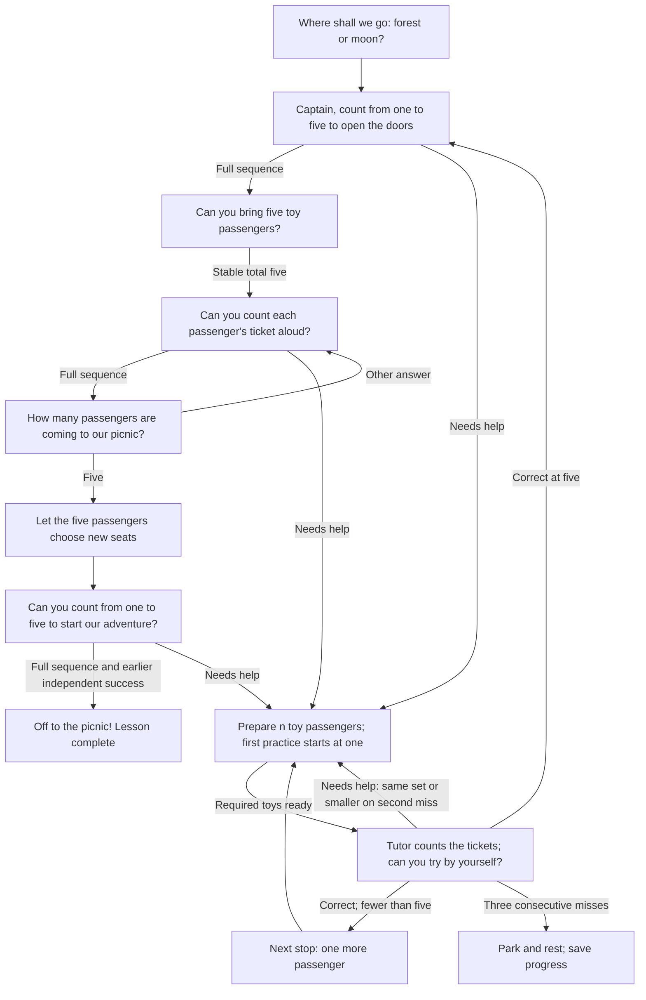

# Lesson 1: Five passengers

The child is the captain. Their toys are passengers waiting for a picnic trip.
They choose **forest** (a bus with “beep beep”) or **moon** (a rocket with
“whoosh”). Counting opens the doors, checks tickets, and starts the engine.
Use any five recognizable toys; the child chooses who each passenger is.

Example: “Ticket check! Can you point to each toy passenger and count them aloud?”
When everyone has a ticket: “Let the five passengers choose new seats!” The child
moves their toys and gives the departure count. These are spoken invitations to
pretend play; there is no bus or rocket animation in the engine.

## Directed cyclic question graph

Arrows returning to earlier questions are actual strategy transitions. Help is
part of the adventure: use a smaller passenger group, count together, and try
again. A cycle can be repeated, with success and rest as reachable exits.

## What counts as success?

The child independently says `1, 2, 3, 4, 5` twice, separated by counting five
real toys and answering the total. No skipped or repeated numbers. Guided
practice and a tap on “5” cannot satisfy an independent sequence check.
The story provides a reason to count; the count remains the acceptance criterion.

## Child controls and engine behavior

- Choose by saying `forest` / `moon` (`лес` / `луна`) or tapping 1 / 2.
- Say `help` / `help me` / `I don't know` (`помоги` / `не знаю`) during a question
  to begin with one passenger. Asking for help does not score an error.
- Say `stop`, `break`, or `I'm tired` (`стоп`, `перерыв`, `я устал`, `я устала`)
  to pause. Repeat and Skip remain available in the app.
- Stable table totals gate toy questions. Table changes cancel pending answers.
  The camera cannot verify one touch per passenger or seating changes.
- Three consecutive unsuccessful responses/timeouts, Stop, or the task limit
  pause. Silence does not create a failed task record. Toy setup has no timeout.
- Save `SessionSummary.remember` to keep the chosen destination and first
  independent success. Resuming after that success returns to the five-passenger
  activity. Completion clears this lesson's checkpoint.

Strategy ID remains `unmath-count-to-five`; app title: **Lesson 1: five passengers**.
English and Russian are supported. The story choice itself never earns a maths score.
