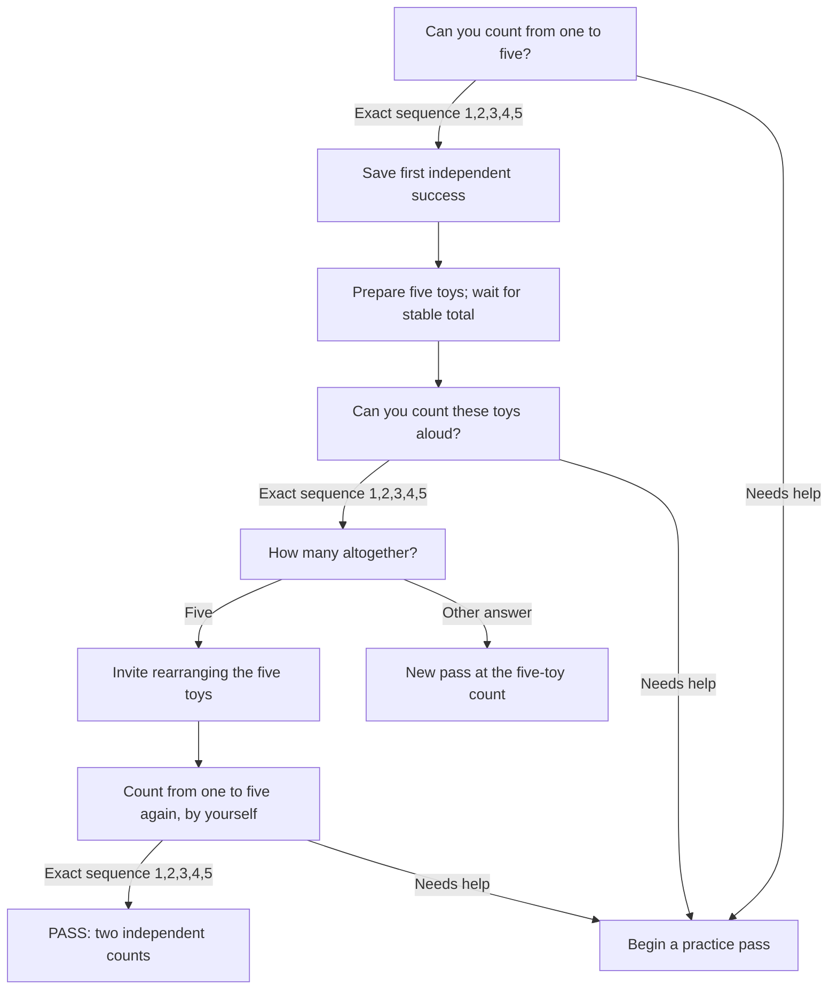
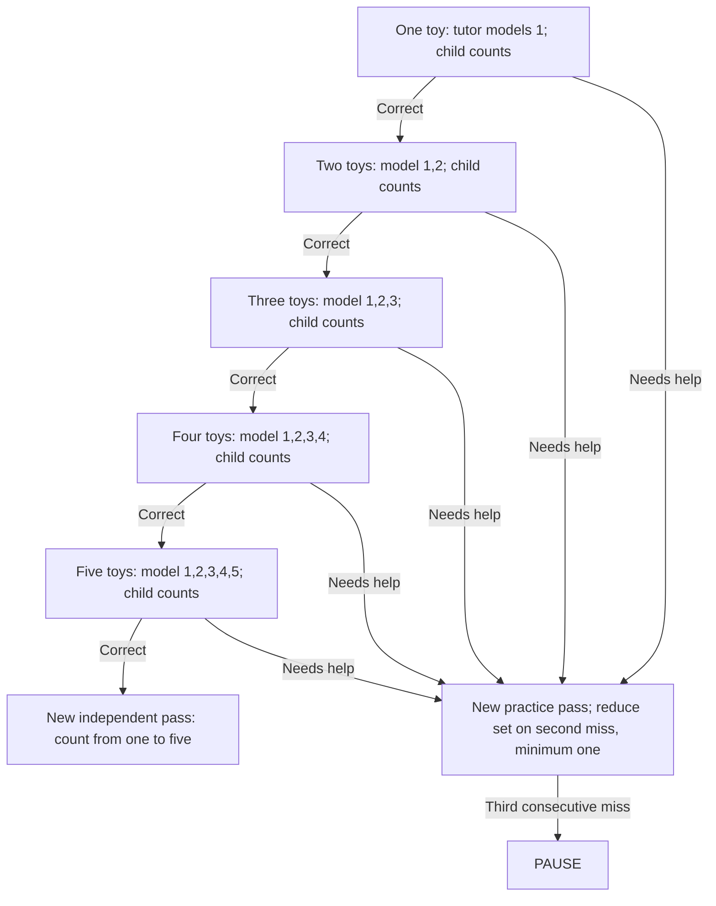

# Lesson 1: Count to five

Strategy: `unmath-count-to-five`.

Goal: independently say `1, 2, 3, 4, 5` twice in order, separated by an activity
counting five real toys and answering the total. A single answer of "five" does
not demonstrate the full sequence. Modeled practice does not earn either
independent success.

## Independent questions (one pass)

## Practice questions (one successful pass)

Stable table totals gate toy questions. A table change cancels the pending toy
answer. The strategy cannot verify one touch per toy or actual rearrangement.
Counting uses the complete `Numbers` sequence, consumed with its following
`Heard` event. Taps cannot satisfy the sequence checks.

Three consecutive unsuccessful responses/timeouts pause. Silence creates no
failed task record. Stop or the task limit also pauses; Repeat reissues the
question; Skip records a skipped attempt and enters practice (subject to the
same limits). Setup has no enforced timeout. Paused sessions preserve the first
independent success and can resume at the five-toy activity.
