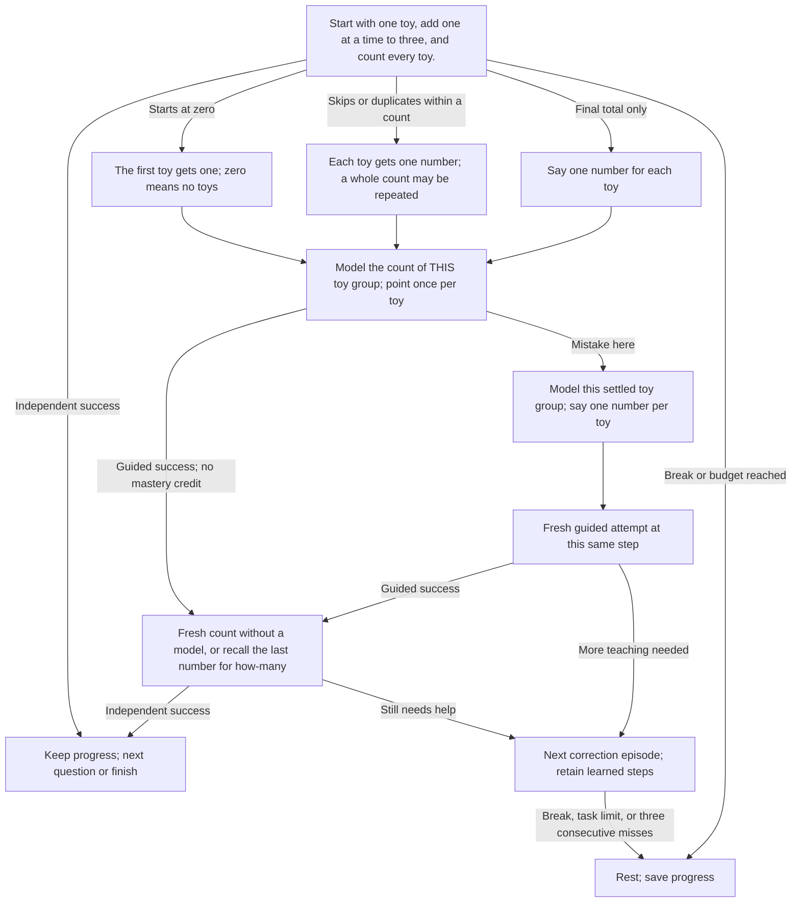

# Lesson 1: Count three toys

Start with one toy, add one at a time to three, and count every toy.

The lesson starts directly with a toy task. There is no destination menu and
no pretend role assigned to any toy. English and Russian prompts describe real
toys and groups of toys. Instructions never ask for a grown-up.

Correct answers may be repeated: `1, 2, 1, 2` for two toys is one successful
response, not two tasks. Each cycle must be complete. Zero-starts, skipped
numbers, duplicates within a count, and incomplete restarts need correction.
After an incorrect spoken answer, the next teaching question begins with
“А ты уверен?” / “Are you sure?” once. Skips and silence do not trigger that prefix.

Begin with only one toy on the table. Add one toy at a time to two and three.
Extra visible toys never skip the opening. One available toy is enough to begin;
three are needed to finish. Independent success requires full counts of three,
a how-many question after counting, and a fresh independent final count.

## Tasks and acceptance

1. Count one toy (modeled).
2. Count two toys (modeled).
3. Independently count three toys.
4. Count the same three toys one by one.
5. Say how many toys there are altogether.
6. Move the toys around and independently count three again.

## Acyclic teaching and correction paths

A mistake opens concrete teaching subquestions, not a restart. Failed guided
counts retry the current group. Later errors revisit only the remaining concept.
The graph unfolds one correction episode into distinct forward nodes. `Continue`
marks the next episode at the current learning step; prompt replays and physical
waiting do not advance it. The session task budget bounds scored steps.

## Controls, progress, and limits

Say `help` / `помоги` for teaching steps; `start again` / `сначала` to repeat the
current prompt; `stop`, `break`, `I'm tired` / `стоп`, `перерыв`, `я устал` to pause.
Help and corrections keep completed work. Guided answers never complete an
independent check. Three consecutive unsuccessful responses/timeouts or the
task budget pause. Skip during toy setup pauses without inventing a failed answer.

Toy setup waits for the required stable detected total. An overshoot during
addition undoes ALL newly added toys, restores the original group, and repeats
the same addition; the child is never asked to subtract the excess. Setup has
no enforced timeout. The camera checks totals, not toy identities or individual
touches; it cannot prove which toys were moved or that two groups were paired.

Save `SessionSummary.remember` between sessions. Completed arithmetic checks
are preserved; legacy destination values are ignored and cleared. English and
Russian use the same transitions. Existing strategy IDs and page URLs remain
compatible with integrations.

Strategy ID: `unmath-count-to-three`. See the [edge-case audit](Edge-case-audit).
