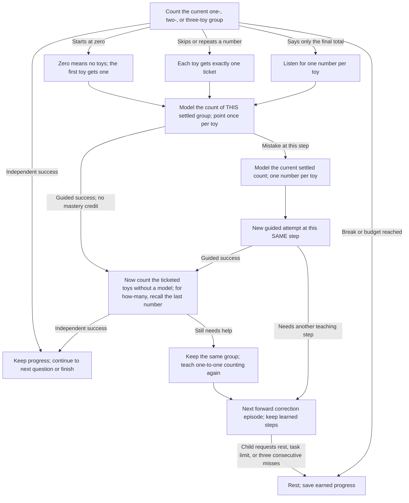

# Lesson 1: Three passengers

Start with **one toy**, then add one friend at a time: **one → two → three**.
The child chooses a forest bus or moon rocket and makes their toys passengers.
Keep other toys aside; extra visible toys never skip the one-toy opening.

Use short spoken turns: “Point to the toy. One! Say one.” Then “One more
friend! Point to each toy. One, two! Your turn.” The first two counts are modeled;
the child then counts three independently, checks tickets, answers how many,
and counts again for departure. Each number belongs to one toy.

This is a gentle starting activity intended for a two-year-old, with a grown-up
helping prepare toys. Pause whenever the child wants; there is no time pressure
for arranging toys. One available toy is enough to begin; three are needed to
complete. With fewer toys, progress is saved at the next stop.

## Acyclic teaching and correction paths

A wrong answer opens the teaching branch below automatically. Each box is a
child action or a smaller question; it is not a replay of the original stem.
The child keeps completed missions. A failed guided response stays at that
physical step. Once the groups are understood, later errors revisit only the
remaining concept. English and Russian use the same transitions.

The graph unfolds a correction episode into distinct forward nodes. `Continue`
is a boundary to the next forward correction episode at the indicated step,
not a jump to the first question. Further scored steps are bounded by the session
task budget; break, skip during setup, or repeated misses can pause. Replaying
a prompt and waiting for stable toys do not advance the teaching graph.
Guided work does not earn mastery: a fresh follow-up is required.

## What counts as success?

Opening counts of one and two never declare mastery. The child must say the
full sequence `1, 2, 3` independently for three actual toys, complete a ticket
count and its total, then independently count `1, 2, 3` again for departure.
A final number alone, zero-start, skipped or repeated number cannot pass a
sequence check. The uninterrupted route takes six scored questions.

## Screen-free controls and progress

Say `forest` or `moon` to choose; `help` to practice with toys and then return to the current question; `start again`
to repeat; `stop`, `break`, or `I'm tired` to rest. English and Russian are supported.
Three consecutive misses/timeouts or the task limit pause without mastery.
Table changes invalidate unfinished counts; pointing while the detected count
stays unchanged does not interrupt. The camera verifies totals, not individual touches.

Strategy: `unmath-count-to-three`; Rust type: `CountToThree`. Old Rust type names
remain compatibility aliases. The old strategy ID is replaced. Old five-toy
checkpoints are ignored; save `SessionSummary.remember` using the new keys
`unmath.lesson1.count_three.v1` and `unmath.lesson1.warmup_three.v1`.

Before lesson 2, separately practice counting four and five with a grown-up:
finishing this lesson demonstrates counting to three, not readiness for all
addition questions up to five.

See the [edge-case audit](Edge-case-audit).
