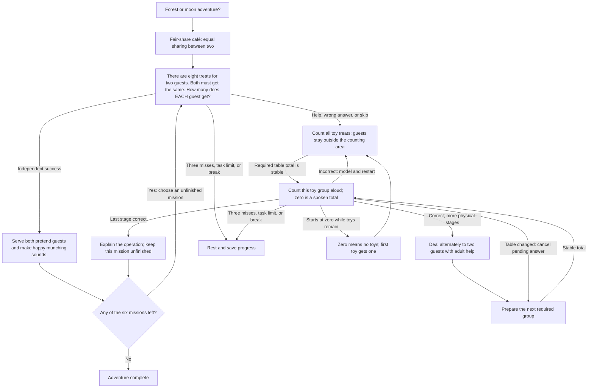

# Lesson 10: Fair-share café

**Skill:** Equal sharing between two. **Prerequisites:** Count to ten; understanding equal amounts.
Prepare **10 recognizable toys**. Story props are optional; real food is not needed.

Run a toy café. Choose two guests and deal pretend treats fairly, one to each in turn.

Example question: “There are eight treats for two guests. Both must get the same. How many does EACH guest get?”

## Directed cyclic question graph

Question nodes represent the current mission, so their numbers change as the
adventure advances. Return arrows are actual strategy transitions. Guided work
never marks a mission complete. After help, another unfinished mission comes
first when possible, and the helped mission returns later.

## Six missions and acceptance

1. Share 2 → 1 each
2. Share 4 → 2 each
3. Share 6 → 3 each
4. Share 8 → 4 each
5. Share 10 → 5 each
6. New guests: share 6 → 3 each

Independently name each guest’s equal share for every mission, including a fresh six-treat situation. This introduces sharing, not formal division notation.

## Toy-based help

1. Count all toy treats; guests stay outside the counting area.
2. Deal alternately to two guests with adult help.
3. Count only the first guest’s share on the table.
4. Replace it with and count only the second guest’s share.

Each camera-visible stage waits for its required stable total and a complete
spoken count (or zero for an empty group). A disturbed table cancels the pending
answer without scoring an error. A wrong guided count is modeled, then preparation
restarts. Setup itself is unscored. The camera verifies totals, not toy identities,
the meaning of the scene, or the child's pointing.

Keep the two guest toys outside the detector's counting area. Ten treats plus two
guests can therefore use twelve toys in the room, but only ten counted at once;
pretend guests can also be hands or imagined characters. The camera cannot
verify equal distribution or distinguish the two shares. An adult should check
the alternating deal and that each presented group belongs to the intended guest.
The independent check measures the child's numerical sharing answer.

## Controls, progress, and integration

Strategy ID: `unmath-share-between-two`. Use `Lesson::FairShareCafe`
with `Adventure::new`, or use the ID through `unmath::register` and the registry.
English and Russian content is included.

Choose forest/moon by voice or tap 1/2. Say `help` / `помоги` during a question
for physical practice; this does not score an error. Say `stop`, `I'm tired`,
`стоп`, or `я устал` to rest, including during setup. Repeat restarts the current
prompt. Skipping a question records a skip and starts help; skipping setup pauses.

Three consecutive unsuccessful responses/timeouts, Stop, or `max_tasks` pauses.
Silence has no task record. Physical setup has no enforced timeout. A successful
uninterrupted adventure takes six tasks, within the default ten-task session.
Guided counts are additional tasks; pause and resume whenever needed.

Persist `SessionSummary.remember` using `apply_remembered` and pass it as the
next `SessionConfig.extra`. The isolated key prefix is
`unmath.lesson10.adventure.v1`; saved values keep completed missions, the next
mission, and forest/moon choice. Guided-stage progress restarts at an independent
question after resuming. Completion clears this lesson's keys.
`final_level` counts independently completed missions (six at completion), while
`correct` also includes guided counts. Insufficient `total_objects` pauses before
any maths task, explaining the required materials.

Success means all six specified challenges were solved independently. It is a
lesson completion check, not a claim of comprehensive fluency or delayed retention.
The story, toys, and reward actions are spoken invitations; no new engine animation
or unimplemented perception feature is assumed.

See the [edge-case audit](Edge-case-audit) for zero-starts, counting mutations,
interruptions, saved-state validation, and engine-boundary regressions.
