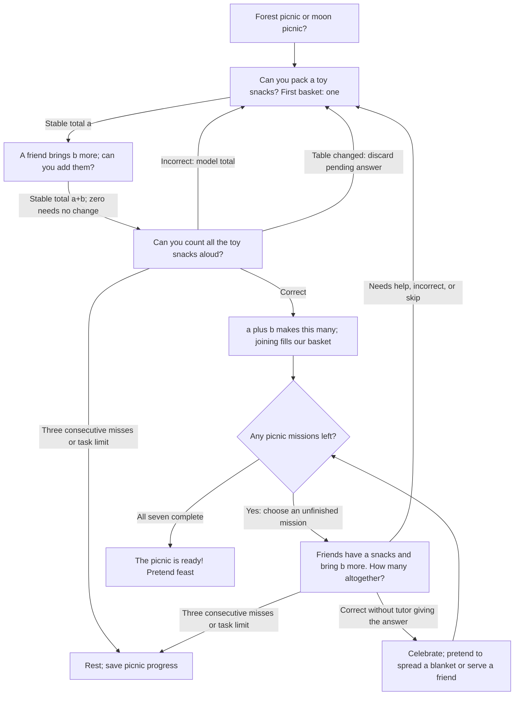

# Lesson 2: Picnic baskets

The passengers have arrived, and the child is in charge of the picnic. Choose
**forest** to feed pretend bears or **moon** to feed pretend aliens. Any toy can
stand for a snack; no real food or special props are needed.

First, pack one toy snack and add another. Count the combined basket. Then solve
seven short picnic missions with totals up to five. Each completed mission earns
a celebration and a pretend action: spread a blanket, pass a basket, pour a drink,
smell the soup, or offer a favorite toy a snack. These actions are invitations,
not tasks judged by the camera.

Example: “The bears have two snacks and bring three more. How many altogether?”
If the child asks for help, build that basket with toys, count it, explain how
joining made the total, and return to the missions. Fingers are always allowed.

## Directed cyclic question graph

The practice path returns to the mission selector, and the success path selects
another mission. These are actual directed cycles with completion and rest exits.

## Challenge scope

| Picnic basket | Addition |
| --- | --- |
| Two snacks | 1 + 1 |
| Three snacks | 1 + 2 |
| Four snacks | 2 + 2 |
| Five snacks | 2 + 3 |
| Four snacks another way | 3 + 1 |
| Five snacks another way | 1 + 4 |
| A friend brings an empty basket | 3 + 0 |

The opening demonstration is guided `1 + 1`. Missions start at `1 + 2`, then
visit each unfinished basket, with `1 + 1` checked independently later. A failed
mission returns after guided play; another unfinished mission comes first when
possible. Adding zero needs no camera change.

## What counts as success?

Correctly solve all seven story missions without the tutor supplying the current
answer. Toy-assisted guided responses do not complete missions. This checks
combining quantities, including two ways to make five; it does not claim mastery
of every addition fact or delayed retention. Independent totals may be spoken or
tapped. Guided counts require the complete sequence `1..a+b`.

## Child controls and engine behavior

The same destination choices, spoken help/break requests, Repeat, and Skip as
lesson one are available. Help rebuilds the current basket without an error
record. Skipping toy setup pauses. Three consecutive mistakes/timeouts, Stop, or
the task limit pause; silence does not create a failed task record. Setup has no
timeout. The camera verifies totals, not food identities or pretend actions.

Default `max_tasks = 10` fits an uninterrupted demonstration plus seven missions.
Use shorter sessions as needed. Persist `SessionSummary.remember` to keep the
chosen friends and completed baskets. The redesigned checkpoint is
`unmath.lesson2.picnic.v2`; old 21-fact scores are not reused. Completion clears
this checkpoint. `final_level` counts completed missions (seven at completion),
while `correct` also counts guided successes.

Strategy ID remains `unmath-add-to-five`; app title: **Lesson 2: picnic baskets**.
Prerequisite: count up to five objects. English and Russian are supported.
