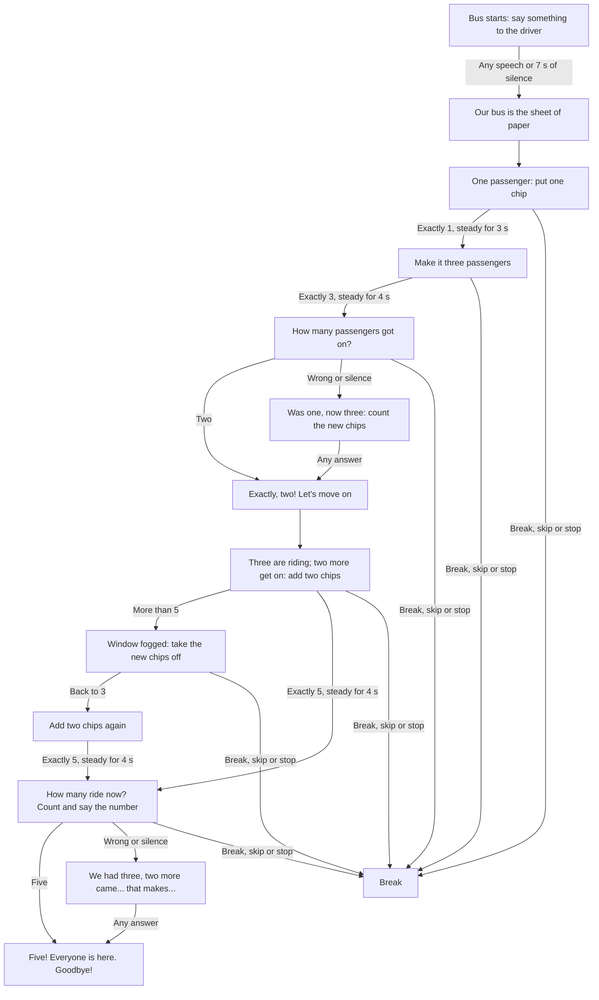

# Lesson 2: The bus (adding to five)

Based on the supplied graph **«Lesson 2_3»**. A sheet of paper on the table is the
bus; chips (or small toys) are its passengers. Everything is spoken: the child
talks, points and moves chips. Have five chips ready. Strategy ID:
`unmath-add-to-five`.

## The ride

1. **Warm-up.** «Дрррм! Наш автобус завёл мотор. Скажи что-нибудь водителю,
   например: поехали!» / "Vroom! Our bus has started its engine…". Any speech,
   or seven seconds of silence, goes on: «Отлично, едем! Наш автобус — это лист
   бумаги на столе.» Not scored.
2. **Round one, completion (1 + ? = 3).** «В автобусе сидит один пассажир.
   Положи одну фишку.» The camera waits silently for exactly one steady chip,
   then a 3-second silent pause for hands to leave. «…Сделай так, чтобы их стало
   три.» The child decides how many to add; the camera waits for exactly three,
   then a 4-second pause. «Датчики видят три фишки. Ты выполнил задание. А теперь
   ответь: сколько именно пассажиров сейчас зашло в автобус?»
   - "Two" gets «Точно, два! Радар зафиксировал твоё действие. Двигаемся дальше.»
   - A wrong answer or silence gets one hint: «Давай проверим. Был один... Стало
     три. Сколько ты добавил? Считай пальчиком новые фишки.» Whatever comes next,
     the ride goes on (with «Точно, два!» only for "two").
3. **Round two, addition (3 + 2).** «Ты уже знаешь, что сейчас в автобусе едут три
   пассажира. Они сидят на местах. На следующей остановке зашли ещё два пассажира.
   Добавь две фишки.» Exactly five, then a 4-second pause. More than five: «Ой, у
   меня запотело стекло. Убери со стола новые фишки, которые ты сейчас положил.»
   Back to exactly three, the same addition is asked again.
   «Автобус поехал! Сколько теперь пассажиров едет в автобусе? Посчитай и назови
   общее число.» Saying "five" or counting aloud to five answers it.
   - A wrong answer or silence gets one hint: «Водитель сбился со счёта. Давай
     вместе: у нас было три, и пришло ещё два... Это...» Whatever comes next:
4. **The end.** «Пять! Все на месте. Сегодня ты отлично справился: сам угадал,
   сколько пассажиров зашло, и правильно сосчитал их в конце поездки. Пока!»

## Controls and records

`help` / `помоги` during a question gives its hint. `start again` / `сначала` /
`повтори` repeats the current instruction; the instruction also repeats every
reminder interval while the chips are not right. `stop`, `break`, `I'm tired` /
`стоп`, `перерыв`, `я устал` pause; so does skip. Every ride starts from the
beginning: nothing is saved between sessions, and old lesson-two checkpoints are
cleared. Records hold the two questions and their hints (up to four answers),
wrong answers included. The lesson needs five toys (`total_objects` ≥ 5).

The camera counts chips, not which chips moved: it cannot tell the new chips from
the old ones when asked to take the new ones off. See the
[edge-case audit](Edge-case-audit).
