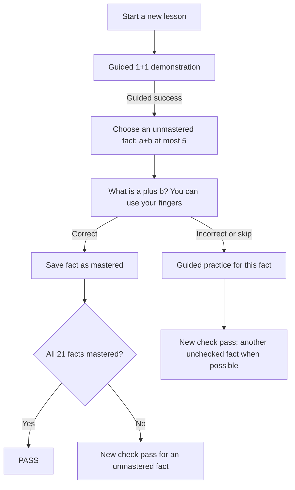
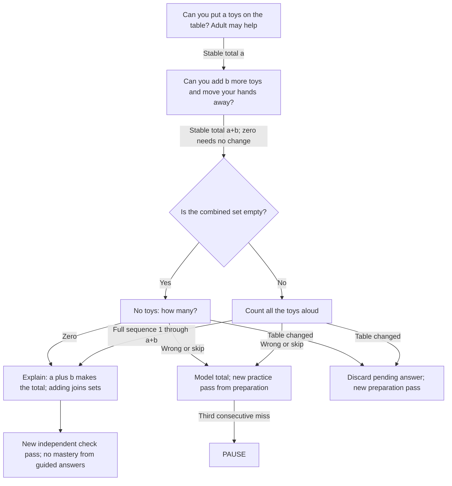

# Lesson 2: Add up to five

Strategy: `unmath-add-to-five`. Prerequisite: count up to five objects.

Goal: independently answer all 21 ordered addition facts with nonnegative
operands and a total no greater than five. Adding zero and reversed operands
are included. Fingers are allowed; memorized recall is not required. Guided
answers do not mark a fact mastered.

## Introduction and independent questions

A resumed lesson with saved mastered facts begins at fact selection and skips
the introductory demonstration. Spoken totals and number-pad answers are both
accepted for independent checks.

## Guided practice questions (one pass)

## Fact coverage

| Total | Ordered facts |
| --- | --- |
| 0 | 0+0 |
| 1 | 0+1, 1+0 |
| 2 | 0+2, 1+1, 2+0 |
| 3 | 0+3, 1+2, 2+1, 3+0 |
| 4 | 0+4, 1+3, 2+2, 3+1, 4+0 |
| 5 | 0+5, 1+4, 2+3, 3+2, 4+1, 5+0 |

This table lists coverage, not the precise selection order. The implementation
uses a fixed order, skips mastered facts, and revisits failed facts after guided
practice. It never asks an addition fact with a total above five.

Three consecutive mistakes/timeouts, Stop, or the task limit pauses. Silence
does not create a failed task record. Repeat reissues the current prompt.
Skipping a question records a skip and starts practice; skipping preparation
pauses. Setup has no enforced timeout. Save `SessionSummary.remember` to resume
with only unmastered facts. Completion clears the addition checkpoint.

Camera observations verify totals, not individual toy identities, the exact
movement of toys, or the child's reasoning. Completion checks current answers;
it does not establish delayed retention.
