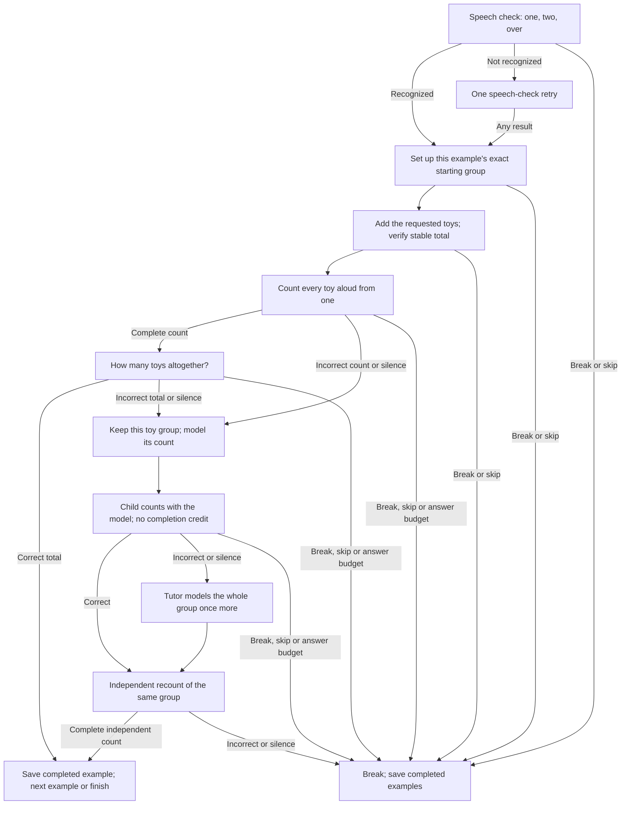
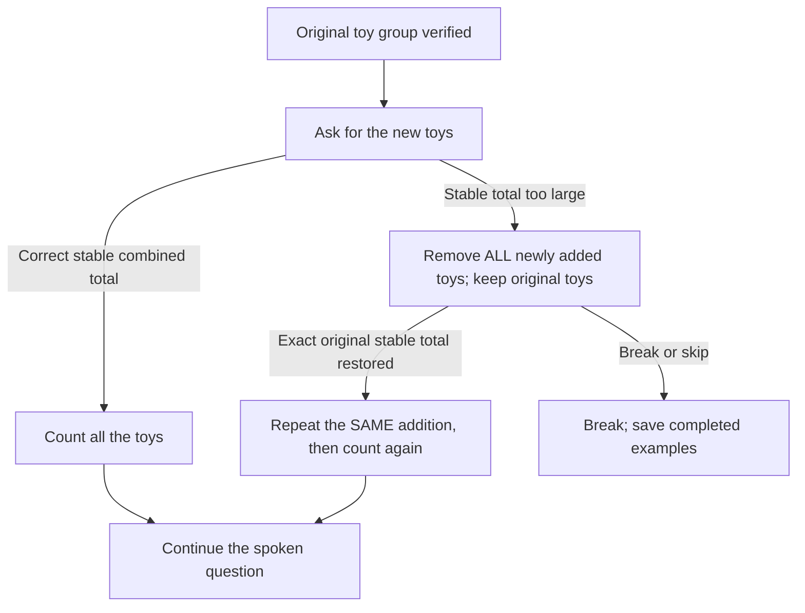

# Lesson 2: Add toys up to five

Based on the supplied **«Урок 2 граф»**: check speech, set up a starting group,
add toys, count every toy aloud, then answer how many there are altogether.
The current app voice is unchanged. Toys stay toys; there are no destination
choices, pretend objects, or requests for grown-up help. All instructions work
without a screen. The tutor introduces itself as Unnum / Уннум.

Readiness: count toys to five before beginning. Lesson one stops at three.
Have five toys available.

## Tasks and acceptance

Play these eight examples in order:

| Example | Start with | Add | Total |
| --- | --- | --- | --- |
| 1 | 1 | 1 | 2 |
| 2 | 1 | 2 | 3 |
| 3 | 2 | 2 | 4 |
| 4 | 2 | 3 | 5 |
| 5 | 3 | 1 | 4 |
| 6 | 1 | 4 | 5 |
| 7 | 3 | 0 | 3 |
| 8 | 1 | 1 | 2 |

At the start of each session, say **«Один, два, приём»** / **“One, two, over.”**
The engine checks the numerical phrase `1,2`; it does not require exact
recognition of the radio word. If it cannot hear a correct phrase, it offers one
retry, then proceeds regardless. This checks contact without scoring arithmetic.
A break or skip pauses immediately, including during this check.

For each example, the camera must see the exact stable starting quantity and
then the exact stable combined quantity. Too few starting toys gets an invitation
to add; too many gets an instruction to leave only the starting quantity.
Unstable/unknown observations never prove completion. Repeated identical frames
do not repeat warnings. Periodic setup reminders do not score answers.
Adding zero leaves the group unchanged and needs no extra camera frame.

A normal success needs a complete count starting at one **and then** a separate
answer to “How many toys are there altogether?” The final number alone is not a
count. For the total question, the final number, repeated identical totals, or a
complete recount are accepted. Complete counts may repeat, such as `1,2,1,2` for
two toys; partial restarts, zero-starts, skipped numbers, and duplicates inside a
count need correction.

## Acyclic teaching and correction paths

A counting error or a wrong total keeps the current assembled group. The tutor
models its count, listens to a guided attempt, then asks for an independent
recount. If the guided attempt fails, the tutor models the group once more and
still offers a fresh independent recount. That independent success completes
the example as specified in the supplied graph; another error or silence pauses
and saves completed examples. Guided answers alone never advance an example.

After an incorrect spoken answer, the next teaching question begins with
**“А ты уверен?” / “Are you sure?”** once. Silence and explicit help do not trigger
that prefix. Explicit help uses the same modeled-count path, without rebuilding
the starting group or discarding completed examples.

This diagram unfolds one example into forward correction paths. `Done` means
advance to the next example, or finish after example eight. The ordered example
sequence and physical retries are separate from this acyclic teaching episode.

## Too many toys were added

The tutor asks the child to remove **ALL newly added toys**, keeping the original
group. Only the exact original stable quantity unlocks the same addition again.
Removing only the excess does not bypass this correction. The child is never
asked to subtract the excess. Physical corrections do not score failed answers.

One physical attempt is shown. The next attempt retains the example index.
An overfull table during a spoken question also triggers this whole-action undo.
An obscured table cancels pending speech without scoring it; restoring the same
quantity resumes the interrupted question. Canceled answer tails are ignored.

## Controls, progress, and limits

In Russian, **«раз» is accepted as «один»**, including `раз, два, раз, два`.
`Ещё раз` / `повтори ещё раз` requests a replay without becoming the number one.

Say `help` / `помоги` for modeled counting; `start again` / `сначала` to repeat the
current instruction; `stop`, `break`, `I'm tired` / `стоп`, `перерыв`, `я устал`
to pause. Skip pauses rather than claiming an example was completed.

Save `SessionSummary.remember` between sessions. The checkpoint
`unmath.lesson2.graph.v4.index` stores the next unfinished example (0–7), never a
partial count or a guided success. Resume repeats the speech check and sets up
that unfinished example. The completed contiguous prefix of old v3 checkpoints
is migrated; obsolete destination keys are ignored and cleared. Invalid and
all-complete checkpoint values restart safely without inventing success.

Each arithmetic response, including a successful count before the total and
attempts in correction paths, consumes the configured `max_tasks` answer budget.
The speech check, prompt replays, and camera corrections do not. A clean complete
run uses 16 responses; use `max_tasks: 40` for room to teach. The default core
budget of 10 pauses and saves progress. Successful final completion clears the
checkpoint. The goodbye uses the configured child name, if supplied; no name or
child gender is hardcoded.

The camera checks quantities, not toy identities or individual touches: it cannot
prove which particular toys were removed. English and Russian share transitions.
Strategy ID: `unmath-add-to-five`. See the [edge-case audit](Edge-case-audit).
