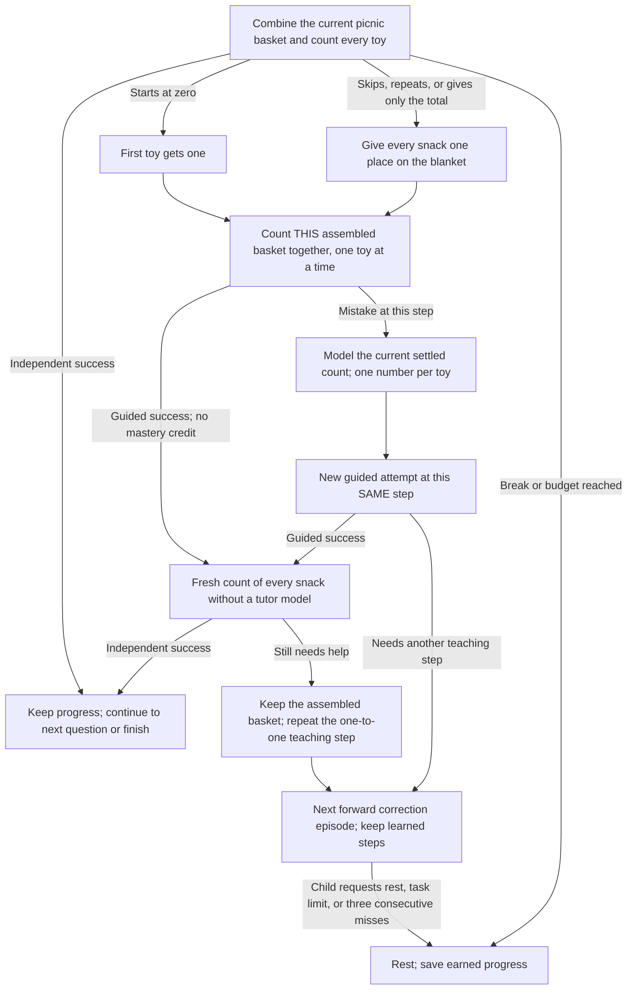
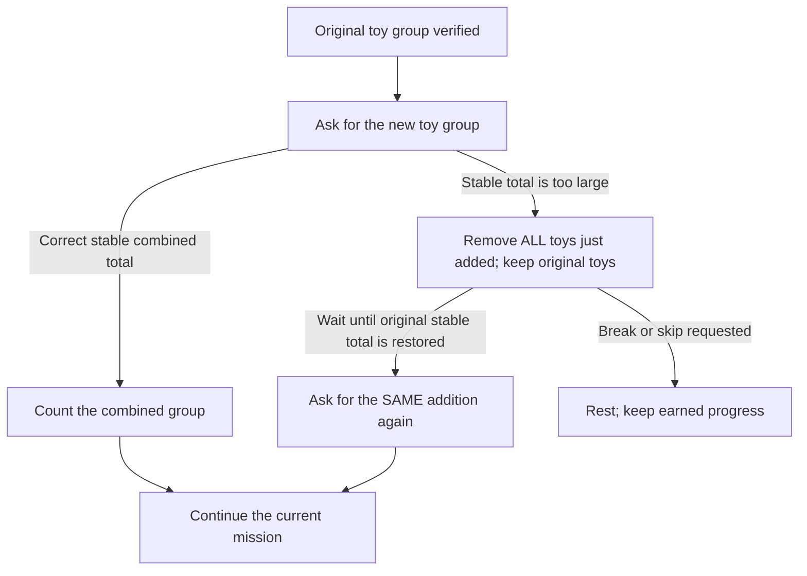

# Lesson 2: Picnic baskets

Prerequisite: count real toys one by one to five. Lesson 1 now stops at three;
practice four and five with a grown-up before beginning these missions.

The passengers have arrived, and the child is in charge of the picnic. Choose
**forest** to feed pretend bears or **moon** to feed pretend aliens. Any toy can
stand for a snack; no real food or special props are needed.

First, pack one toy snack and add another. Count the combined basket. Then solve
seven short picnic missions with totals up to five. Each completed mission earns
a celebration and a pretend action: spread a blanket, pass a basket, pour a drink,
smell the soup, or offer a favorite toy a snack. These actions are invitations,
not tasks judged by the camera.

Example: “The bears have two snacks and bring three more. Point to the toy
snacks one by one and say one number for each, starting at one.”
If the child asks for help, build that basket with toys, count it, explain how
joining made the total, and return to the missions. Use the actual toy basket for each count.

## Acyclic teaching and correction paths

A wrong answer opens the teaching branch below automatically. Each box is a
child action or a smaller question; it is not a replay of the original stem.
The child keeps completed missions. A failed guided response stays at that
physical step. Once the groups are understood, later errors revisit only the
remaining concept. English and Russian use the same transitions.

The graph unfolds a correction episode into distinct forward nodes. `Continue`
is a boundary to the next forward correction episode at the indicated step,
not a jump to the first question. Further scored steps are bounded by the session
task budget; break, skip during setup, or repeated misses can pause. Replaying
a prompt and waiting for stable toys do not advance the teaching graph.
Guided work does not earn mastery: a fresh follow-up is required.

## Too many toys were added

If the child is asked to add two toys but adds three, the tutor says:
“Too many toys joined. Put ALL the toys you just added back beside the table.
Leave the toys that were here before. A grown-up can help.”

The child undoes the whole attempted addition. The tutor waits for the original
stable total, then asks for the original addition again. It never asks the child
to calculate an excess or remove just that many toys. Even passing through the
correct combined total during removal does not bypass the reset. Setup errors
do not score failed answers or erase completed missions. Partial additions and
moving/unknown observations do not trigger this overshoot correction.

This acyclic segment shows one physical setup attempt. The retry opens a new
attempt of the same addition; it does not restart the lesson. Physical setup
has no enforced timeout or fixed retry count. The camera verifies totals, not
which individual toys were removed; a grown-up can help keep the original group.

## Challenge scope

| Picnic basket | Addition |
| --- | --- |
| Two snacks | 1 + 1 |
| Three snacks | 1 + 2 |
| Four snacks | 2 + 2 |
| Five snacks | 2 + 3 |
| Four snacks another way | 3 + 1 |
| Five snacks another way | 1 + 4 |
| A friend brings an empty basket | 3 + 0 |

The opening demonstration is guided `1 + 1`. Missions start at `1 + 2`, then
visit each unfinished basket, with `1 + 1` checked independently later. A failed
count opens a modeled one-to-one counting question for that same basket, then
a fresh independent count. Explicit help
rebuilds that basket and then checks it independently; completed missions stay complete. Adding zero needs no camera change.

## What counts as success?

Build and count all seven real toy baskets without the tutor modeling the
current count. Each mission waits for the starting group, the added group, and
a stable combined total before listening. Toy-assisted guided responses do not complete missions. This checks
combining quantities, including two ways to make five; it does not claim mastery
of every addition fact or delayed retention. Both independent and guided counts require the full sequence `1..a+b`. A lone
final number or a sequence with skipped/repeated numbers cannot complete
a basket. After a correct count, the tutor names the total to connect counting
with “how many altogether.”

## Child controls and engine behavior

The same spoken destination choices, help/break requests, and restart requests
as lesson one are available; no screen interaction is required. Help rebuilds the current basket without an error
record. Skipping toy setup pauses. Three consecutive mistakes/timeouts, Stop, or
the task limit pause; silence does not create a failed task record. Setup has no
timeout. The camera verifies totals, not food identities or pretend actions.

Default `max_tasks = 10` fits an uninterrupted demonstration plus seven missions.
Use shorter sessions as needed. Persist `SessionSummary.remember` to keep the
chosen friends and completed baskets. The redesigned checkpoint is
`unmath.lesson2.one_by_one.v3`; older final-number and 21-fact scores are not reused. Completion clears
this checkpoint. `final_level` counts completed missions (seven at completion),
while `correct` also counts guided successes.

Strategy ID remains `unmath-add-to-five`; app title: **Lesson 2: picnic baskets**.
Prerequisite: count up to five objects. English and Russian are supported.

The camera verifies totals and the recognizer verifies the spoken sequence.
A grown-up can observe one touch per toy; the strategy API cannot verify unique
physical touches. Counts can span pauses in `ListenMode::Counting`.

See the [edge-case audit](Edge-case-audit) for zero-starts, counting mutations,
interruptions, saved-state validation, and engine-boundary regressions.
