# Lesson 5: Parcel detectives

**Skill:** Missing addends within five. **Prerequisites:** Addition within five; comparison helps.
Prepare **5 recognizable toys**. Story props are optional; real food is not needed.

Be a parcel detective: deliveries have a target size, but some parcels are missing.

Example question: “The delivery needs five parcels. We have two. How many more do we need?”

## Acyclic correction paths

Each scored question has a forward path: first attempt, a specific correction,
a fresh attempt, another correction, and a final attempt. A correct answer
advances to the next question; three consecutive misses pause. Completed work
is kept. A mistake never sends the child to the first question.

The diagram expands the ordinary answer/correction route into separate attempt
nodes, so it is acyclic. It omits table-waiting events, replay requests, and the
optional physical-help walkthrough. Help keeps the current mission; mistakes
during help retry the current physical stage. After help, the same mission gets
a fresh independent check. Guided work never earns independent mastery.
The task limit or a requested break may pause earlier than shown.

```mermaid
flowchart TD
    Choose["Choose forest or moon; prepare the current toys"] --> Q0A1
    Q0A1["Have 1 parcel; need 3. How many more?: attempt 1"] -->|"Correct"| Q1A1
    Q0A1 -->|"Mistake or skip"| Q0C1["Count only NEW parcels needed to fill the order"]
    Q0C1 --> Q0A2["Same question: attempt 2"]
    Q0A2 -->|"Correct"| Q1A1
    Q0A2 -->|"Mistake or skip"| Q0C2["Repeat the local hint; keep this question"]
    Q0C2 --> Q0A3["Same question: attempt 3"]
    Q0A3 -->|"Correct"| Q1A1
    Q0A3 -->|"Third consecutive miss"| Rest["Rest; save earned progress"]
    Q1A1["Have 2 parcels; need 5. How many more?: attempt 1"] -->|"Correct"| Q2A1
    Q1A1 -->|"Mistake or skip"| Q1C1["Count only NEW parcels needed to fill the order"]
    Q1C1 --> Q1A2["Same question: attempt 2"]
    Q1A2 -->|"Correct"| Q2A1
    Q1A2 -->|"Mistake or skip"| Q1C2["Repeat the local hint; keep this question"]
    Q1C2 --> Q1A3["Same question: attempt 3"]
    Q1A3 -->|"Correct"| Q2A1
    Q1A3 -->|"Third consecutive miss"| Rest["Rest; save earned progress"]
    Q2A1["Have 3 parcels; need 4. How many more?: attempt 1"] -->|"Correct"| Q3A1
    Q2A1 -->|"Mistake or skip"| Q2C1["Count only NEW parcels needed to fill the order"]
    Q2C1 --> Q2A2["Same question: attempt 2"]
    Q2A2 -->|"Correct"| Q3A1
    Q2A2 -->|"Mistake or skip"| Q2C2["Repeat the local hint; keep this question"]
    Q2C2 --> Q2A3["Same question: attempt 3"]
    Q2A3 -->|"Correct"| Q3A1
    Q2A3 -->|"Third consecutive miss"| Rest["Rest; save earned progress"]
    Q3A1["Have 4 parcels; need 5. How many more?: attempt 1"] -->|"Correct"| Q4A1
    Q3A1 -->|"Mistake or skip"| Q3C1["Count only NEW parcels needed to fill the order"]
    Q3C1 --> Q3A2["Same question: attempt 2"]
    Q3A2 -->|"Correct"| Q4A1
    Q3A2 -->|"Mistake or skip"| Q3C2["Repeat the local hint; keep this question"]
    Q3C2 --> Q3A3["Same question: attempt 3"]
    Q3A3 -->|"Correct"| Q4A1
    Q3A3 -->|"Third consecutive miss"| Rest["Rest; save earned progress"]
    Q4A1["Have 0 parcels; need 2. How many more?: attempt 1"] -->|"Correct"| Q5A1
    Q4A1 -->|"Mistake or skip"| Q4C1["Count only NEW parcels needed to fill the order"]
    Q4C1 --> Q4A2["Same question: attempt 2"]
    Q4A2 -->|"Correct"| Q5A1
    Q4A2 -->|"Mistake or skip"| Q4C2["Repeat the local hint; keep this question"]
    Q4C2 --> Q4A3["Same question: attempt 3"]
    Q4A3 -->|"Correct"| Q5A1
    Q4A3 -->|"Third consecutive miss"| Rest["Rest; save earned progress"]
    Q5A1["Have 5 parcels; need 5. How many more?: attempt 1"] -->|"Correct"| Done
    Q5A1 -->|"Mistake or skip"| Q5C1["Count only NEW parcels needed to fill the order"]
    Q5C1 --> Q5A2["Same question: attempt 2"]
    Q5A2 -->|"Correct"| Done
    Q5A2 -->|"Mistake or skip"| Q5C2["Repeat the local hint; keep this question"]
    Q5C2 --> Q5A3["Same question: attempt 3"]
    Q5A3 -->|"Correct"| Done
    Q5A3 -->|"Third consecutive miss"| Rest["Rest; save earned progress"]
    Done["Lesson complete"]
```

## Six missions and acceptance

1. 1 + ? = 3 → 2
2. 2 + ? = 5 → 3
3. 3 + ? = 4 → 1
4. 4 + ? = 5 → 1
5. 0 + ? = 2 → 2
6. 5 + ? = 5 → 0

Independently find the six missing additions, including starting empty and needing no extra parcels.

## Toy-based help

1. Prepare the starting parcels.
2. Add one at a time until the target total.
3. Count only NEW parcels while adding; recount the total.

Each camera-visible stage waits for its required stable total and a complete
spoken count (or zero for an empty group). A disturbed table cancels the pending
answer without scoring an error. A wrong guided count is modeled, then preparation
restarts. Setup itself is unscored. The camera verifies totals, not toy identities,
the meaning of the scene, or the child's pointing.

## Controls, progress, and integration

Strategy ID: `unmath-missing-to-five`. Use `Lesson::ParcelDetectives`
with `Adventure::new`, or use the ID through `unmath::register` and the registry.
English and Russian content is included.

Choose forest or moon by saying its name. Say `help` / `помоги` during a question
for physical practice; this does not score an error. Say `stop`, `I'm tired`,
`стоп`, or `я устал` to rest, including during setup. Repeat restarts the current
prompt. Skipping a question records a skip and starts help; skipping setup pauses.

Three consecutive unsuccessful responses/timeouts, Stop, or `max_tasks` pauses.
Silence has no task record. Physical setup has no enforced timeout. A successful
uninterrupted adventure takes six tasks, within the default ten-task session.
Guided counts are additional tasks; pause and resume whenever needed.

Persist `SessionSummary.remember` using `apply_remembered` and pass it as the
next `SessionConfig.extra`. The isolated key prefix is
`unmath.lesson5.adventure.v1`; saved values keep completed missions, the next
mission, and forest/moon choice. Guided-stage progress restarts at an independent
question after resuming. Completion clears this lesson's keys.
`final_level` counts independently completed missions (six at completion), while
`correct` also includes guided counts. Insufficient `total_objects` pauses before
any maths task, explaining the required materials.

Success means all six specified challenges were solved independently. It is a
lesson completion check, not a claim of comprehensive fluency or delayed retention.
The story, toys, and reward actions are spoken invitations; no new engine animation
or unimplemented perception feature is assumed.

See the [edge-case audit](Edge-case-audit) for zero-starts, counting mutations,
interruptions, saved-state validation, and engine-boundary regressions.
