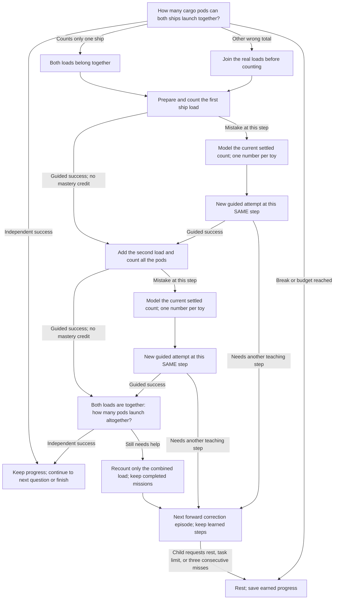
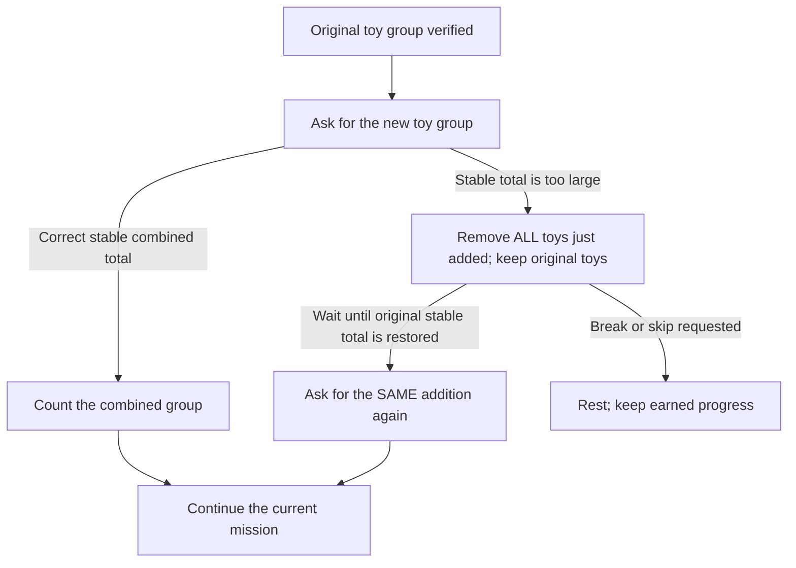

# Lesson 7: Supply launch

**Skill:** Combining quantities with totals six through ten. **Prerequisites:** Count to ten; addition within five.
Prepare **10 recognizable toys**. Story props are optional; real food is not needed.

Be mission control. Join toy cargo pods from two ships to launch supplies.

Example question: “One ship brings five pods and another brings three. How many can we launch altogether?”

## Acyclic teaching and correction paths

A child may repeat the whole correct answer. For two toys, `1, 2, 1, 2`
(or “один, два, один, два”) is one successful response. Each repetition must be
a complete `1..n` count, in order, ending at the actual toy total. Repetitions
never earn extra task completions or replace a later independent question.
Skipped numbers, incomplete restarts, and repeating one number inside a count
remain correction cases. Long valid repetitions are checked in full, then
compacted for bounded saved diagnostics; a late error is never discarded.

After an incorrect spoken answer, the next teaching question begins with
**“А ты уверен?”** in Russian (**“Are you sure?”** in English). The prefix is
spoken once, after any setup wait; skips and silence do not trigger it.

A wrong answer opens the teaching branch below automatically. Each box is a
child action or a smaller question; it is not a replay of the original stem.
The child keeps completed missions. A failed guided response stays at that
physical step. Once the groups are understood, later errors revisit only the
remaining concept. English and Russian use the same transitions.

The graph unfolds a correction episode into distinct forward nodes. `Continue`
is a boundary to the next forward correction episode at the indicated step,
not a jump to the first question. Further scored steps are bounded by the session
task budget; break, skip during setup, or repeated misses can pause. Replaying
a prompt and waiting for stable toys do not advance the teaching graph.
Guided work does not earn mastery: a fresh follow-up is required.

## Too many toys were added

If the child is asked to add two toys but adds three, the tutor says:
“Too many toys joined. Put ALL the toys you just added back beside the table.
Leave the toys that were here before. A grown-up can help.”

The child undoes the whole attempted addition. The tutor waits for the original
stable total, then asks for the original addition again. It never asks the child
to calculate an excess or remove just that many toys. Even passing through the
correct combined total during removal does not bypass the reset. Setup errors
do not score failed answers or erase completed missions. Partial additions and
moving/unknown observations do not trigger this overshoot correction.

This acyclic segment shows one physical setup attempt. The retry opens a new
attempt of the same addition; it does not restart the lesson. Physical setup
has no enforced timeout or fixed retry count. The camera verifies totals, not
which individual toys were removed; a grown-up can help keep the original group.

## Six missions and acceptance

1. 5 + 1 = 6
2. 4 + 3 = 7
3. 5 + 3 = 8
4. 4 + 5 = 9
5. 5 + 5 = 10
6. 6 + 2 = 8

Independently solve all six cargo additions, including a total of ten and another way to make eight.

## Toy-based help

1. Prepare the first ship’s cargo.
2. Bring the second ship’s cargo onto the table.
3. Count the combined load.

Each camera-visible stage waits for its required stable total and a complete
spoken count (or zero for an empty group). A disturbed table cancels the pending
answer without scoring an error. A wrong guided count is modeled, then that same physical stage is tried again. Setup itself is unscored. The camera verifies totals, not toy identities,
the meaning of the scene, or the child's pointing.

## Controls, progress, and integration

Strategy ID: `unmath-add-to-ten`. Use `Lesson::SupplyLaunch`
with `Adventure::new`, or use the ID through `unmath::register` and the registry.
English and Russian content is included.

Choose forest or moon by saying its name. Say `help` / `помоги` during a question
for physical practice; this does not score an error. Say `stop`, `I'm tired`,
`стоп`, or `я устал` to rest, including during setup. Repeat restarts the current
prompt. Skipping a question records a skip and starts help; skipping setup pauses.

Three consecutive unsuccessful responses/timeouts, Stop, or `max_tasks` pauses.
Silence has no task record. Physical setup has no enforced timeout. A successful
uninterrupted adventure takes six tasks, within the default ten-task session.
Guided counts are additional tasks; pause and resume whenever needed.

Persist `SessionSummary.remember` using `apply_remembered` and pass it as the
next `SessionConfig.extra`. The isolated key prefix is
`unmath.lesson7.adventure.v1`; saved values keep completed missions, the next
mission, and forest/moon choice. Guided-stage progress restarts at an independent
question after resuming. Completion clears this lesson's keys.
`final_level` counts independently completed missions (six at completion), while
`correct` also includes guided counts. Insufficient `total_objects` pauses before
any maths task, explaining the required materials.

Success means all six specified challenges were solved independently. It is a
lesson completion check, not a claim of comprehensive fluency or delayed retention.
The story, toys, and reward actions are spoken invitations; no new engine animation
or unimplemented perception feature is assumed.

See the [edge-case audit](Edge-case-audit) for zero-starts, counting mutations,
interruptions, saved-state validation, and engine-boundary regressions.
