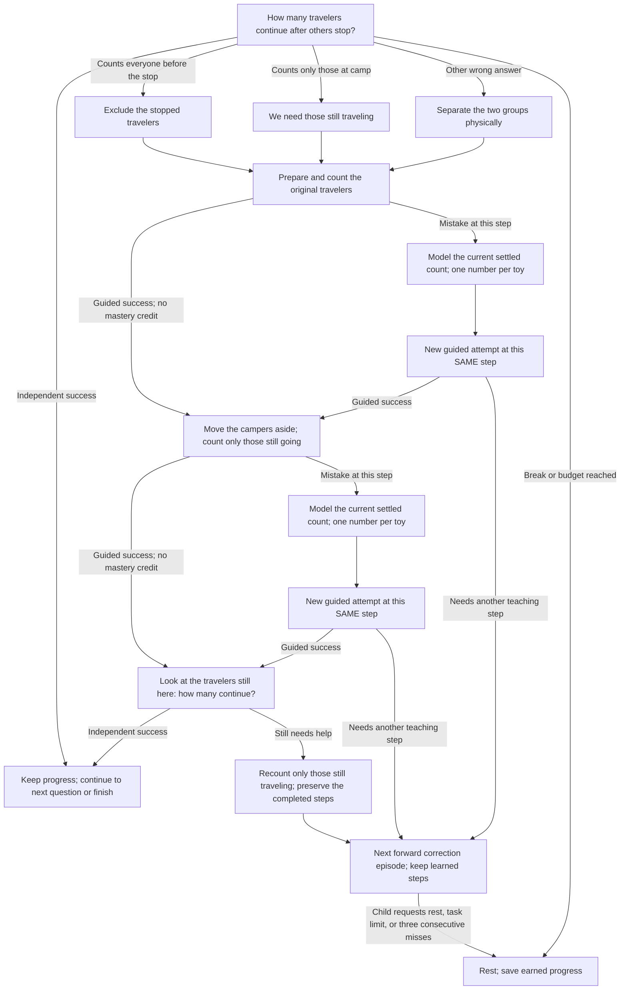

# Lesson 8: Homeward trail

**Skill:** Taking away within ten. **Prerequisites:** Count to ten; subtraction within five.
Prepare **10 recognizable toys**. Story props are optional; real food is not needed.

Guide toy travelers home. Some stop at camp; find how many keep traveling.

Example question: “Ten travelers set out. Five stop at camp. How many keep traveling?”

## Acyclic teaching and correction paths

A wrong answer opens the teaching branch below automatically. Each box is a
child action or a smaller question; it is not a replay of the original stem.
The child keeps completed missions. A failed guided response stays at that
physical step. Once the groups are understood, later errors revisit only the
remaining concept. English and Russian use the same transitions.

The graph unfolds a correction episode into distinct forward nodes. `Continue`
is a boundary to the next forward correction episode at the indicated step,
not a jump to the first question. Further scored steps are bounded by the session
task budget; break, skip during setup, or repeated misses can pause. Replaying
a prompt and waiting for stable toys do not advance the teaching graph.
Guided work does not earn mastery: a fresh follow-up is required.

## Six missions and acceptance

1. 6 - 1 = 5
2. 7 - 3 = 4
3. 8 - 2 = 6
4. 9 - 4 = 5
5. 10 - 5 = 5
6. 10 - 10 = 0

Independently solve all six departures, including an empty trail when everyone stops.

## Toy-based help

1. Prepare the traveling group.
2. Take the campers off the table.
3. Count the remaining travelers, including zero.

Each camera-visible stage waits for its required stable total and a complete
spoken count (or zero for an empty group). A disturbed table cancels the pending
answer without scoring an error. A wrong guided count is modeled, then that same physical stage is tried again. Setup itself is unscored. The camera verifies totals, not toy identities,
the meaning of the scene, or the child's pointing.

## Controls, progress, and integration

Strategy ID: `unmath-subtract-to-ten`. Use `Lesson::HomewardTrail`
with `Adventure::new`, or use the ID through `unmath::register` and the registry.
English and Russian content is included.

Choose forest or moon by saying its name. Say `help` / `помоги` during a question
for physical practice; this does not score an error. Say `stop`, `I'm tired`,
`стоп`, or `я устал` to rest, including during setup. Repeat restarts the current
prompt. Skipping a question records a skip and starts help; skipping setup pauses.

Three consecutive unsuccessful responses/timeouts, Stop, or `max_tasks` pauses.
Silence has no task record. Physical setup has no enforced timeout. A successful
uninterrupted adventure takes six tasks, within the default ten-task session.
Guided counts are additional tasks; pause and resume whenever needed.

Persist `SessionSummary.remember` using `apply_remembered` and pass it as the
next `SessionConfig.extra`. The isolated key prefix is
`unmath.lesson8.adventure.v1`; saved values keep completed missions, the next
mission, and forest/moon choice. Guided-stage progress restarts at an independent
question after resuming. Completion clears this lesson's keys.
`final_level` counts independently completed missions (six at completion), while
`correct` also includes guided counts. Insufficient `total_objects` pauses before
any maths task, explaining the required materials.

Success means all six specified challenges were solved independently. It is a
lesson completion check, not a claim of comprehensive fluency or delayed retention.
The story, toys, and reward actions are spoken invitations; no new engine animation
or unimplemented perception feature is assumed.

See the [edge-case audit](Edge-case-audit) for zero-starts, counting mutations,
interruptions, saved-state validation, and engine-boundary regressions.
